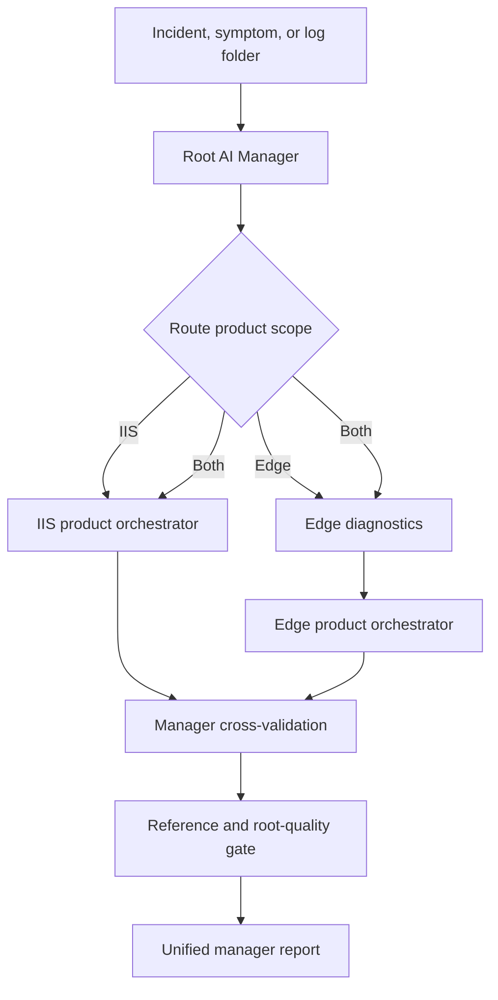

# SkillsCollection Diagnostic Manager

The root `orchestrator` is the canonical AI-manager entry for Microsoft IIS
and Edge incidents. It determines product scope, delegates evidence analysis
to product skills, reconciles results through multiple validation rounds, and
generates one evidence-grounded report.



## What The Manager Owns

- Deterministic IIS/Edge/both routing with explicit ambiguity handling.
- Bounded folder evidence inventory.
- Product delegate execution with timeout, contract, exit-code, and stderr
  privacy boundaries.
- Product-local, manager-level, and deterministic consistency validation.
- Evidence-chain and invocation-chain preservation.
- Possible causes tied to evidence IDs and falsifiers.
- Solutions tied to evidence IDs and verification/rollback criteria.
- Missing-log status and operator-reviewed collection plans.
- Self-contained, redacted English and Chinese HTML reporting with readable
  problem/process/cause/solution/next-action sections, cross-validation
  agreements and differences, per-module confidence, and skill work summaries.

## Usage

```powershell
python orchestrator/scripts/orchestrator.py C:\incident `
  --report C:\incident\manager-report.html

python orchestrator/scripts/orchestrator.py `
  '{"question":"Edge receives 500 from an IIS application","products":["Edge","IIS"]}' `
  --report manager-report.html
```

This creates:

- `C:\incident\manager-report.html` (English)
- `C:\incident\manager-report.zh-CN.html` (Chinese)

The Chinese report localizes report prose and headings while preserving raw
technical evidence and commands when translation could alter their meaning.

Use `--product IIS`, `--product Edge`, or `--product both` when evidence alone
cannot establish scope. Generic EVTX/PML files are intentionally ambiguous.

## Compatibility

The scripts under `IIS/orchestrator/` and `Edge/orchestrator/` remain available
for existing automation and product-internal delegation. New investigations
should enter through the root manager.

See [orchestrator/SKILL.md](orchestrator/SKILL.md),
[IIS/AGENTS.md](IIS/AGENTS.md), and [Edge/AGENTS.md](Edge/AGENTS.md).