# SAGE 完整架构设计

> **项目名称：** SAGE（Skill Agent Governance Engine）  
> **系统定位：** Agent Skills 的事务式发布与运行控制层  
> **核心主张：** 为 Agent Skills 提供 GitOps 式验证、不可变发布、Direct/Agent 一致执行、请求级版本固定和失败回滚  
> **文档版本：** 0.3  
> **架构状态：** 本地控制面与执行面闭环已实现；生产持久化和身份体系待建设  
> **关联文档：** [Hackathon 中文提案](hackathon-proposal.zh-CN.md) · [Hackathon English Proposal](hackathon-proposal.en.md)

---

## 1. 文档目的

本文档描述 SAGE 的完整架构体系，包括：

- Skill、Tool、Agent、MCP、Plugin 等核心概念的边界
- Skill 的共享、个性化、版本和改进模型
- Agent 的统一 Runtime、动态能力视图和命名 Agent 模型
- 控制面、执行面、学习面和基础设施面的完整模块
- Direct、Agent、发布、回滚和反馈学习的核心时序
- API、事件、存储、安全、可观测性和部署设计
- Hackathon MVP 与企业生产架构之间的演进关系

本文档服务于架构评审、团队分工、接口协作、实现规划和后续生产化决策。

### 1.1 当前实现基线（2026-09-04）

| 范围 | 已实现 | 暂缓 |
|---|---|---|
| Runtime Context | 不可变 Principal、Run、Thread、Generation 和 mode；贯穿 API、Agent、Executor 与 Adapter | 真实登录身份解析 |
| Capability / Policy | Registry 投影为 Capability View；发现和执行双重授权；高风险返回审批决策 | RBAC 数据库、审批恢复 |
| Agent | 声明式定义、不可变 Catalog、草稿 CRUD/验证/克隆、Candidate 发布、用户隔离 checkpoint key | 持久 Checkpointer、真实用户 RBAC |
| Adapter | 可注入 Registry；builtin、受信任本地 subprocess、独立 Python Runner、HTTP alias、MCP Gateway Adapter | 每调用强沙箱、HTTP 管理页 |
| MCP | 官方 SDK HTTP/stdio、server allowlist/preset、测试、发现、双 digest 固定、Tool 导入 | 独立进程部署、IP pinning、企业 Secret Store |
| Catalog | Candidate、内容重验、diff digest、审批、原子激活、回滚和 thread pinning | PostgreSQL CAS、多实例 lease |
| Control UI | `/admin` 的 Agent、Skill、MCP、Catalog 与 Approval 页面 | 细粒度 RBAC、审计导出 |
| Run | RunStore 端口、内存实现、有序事件、终态保护、同步与 SSE 记录 | PostgreSQL、Worker lease、重放 API |
| Result | JSON Schema、输出预算及声明式 Result Validator Registry | 通用 evidence contract 与 artifact retention |

控制面元数据与 Generation Artifact 当前保存在本地 `.sage-state/`，使用 flush、fsync 和原子 replace，支持单进程重启恢复。本轮明确暂不实现 PostgreSQL repository 和本地账户/API Key；Checkpointer、Run 与附件仍为临时存储。

控制面的详细状态机、API、目录结构和威胁约束见 [控制面实现设计](control-plane.zh-CN.md)。

---

## 2. 执行视图

### 2.1 一句话架构

SAGE 将经过验证的 Skills 构建为不可变 Catalog Generation；每个请求先解析身份、能力视图和 Generation，再选择零 LLM 的 Direct 路径或受预算约束的 Agent 路径，并把执行反馈送入独立的改进流水线，而不是直接修改生产 Skill。

### 2.2 核心闭环

```text
Skill Source
  -> Validate
  -> Evaluate
  -> Build Candidate
  -> Activate Generation
  -> Resolve User Capability View
  -> Direct or Agent Execution
  -> Observe and Collect Feedback
  -> Propose Next Candidate
```

### 2.3 架构目标

1. **可复用**：把 Prompt、脚本、Tool、MCP 和 HTTP API 转化为统一能力。
2. **可确定**：明确目标的任务不经过 LLM。
3. **可组合**：复杂任务由 Agent 渐进发现并组合 Skills。
4. **可治理**：输入输出、权限、超时、网络和副作用由服务器执行。
5. **可发布**：一组 Skills 作为完整 Generation 原子生效。
6. **可一致**：请求和会话在执行期间固定到同一 Generation。
7. **可恢复**：候选版本失败时旧 Generation 继续服务。
8. **可个性化**：统一 Runtime 根据用户、团队、角色和会话解析不同能力视图。
9. **可改进**：每次执行产生学习信号，但生产 Skill 只能通过评测和审批发布。
10. **可替换**：Agent、Gateway、评测和 Sandbox 均通过接口集成，避免框架锁定。

### 2.4 非目标

SAGE 不计划重新实现：

- Agent Skills 基础规范
- 通用大模型或推理引擎
- 重新实现完整 MCP transport、连接池与生态 Registry
- SaaS 应用集成市场
- 通用低代码工作流平台
- 通用 Agent Framework
- 完整容器编排或 Sandbox 平台
- 企业身份提供商
- 通用 Prompt Marketplace

上述能力优先复用 Agent Skills、Deep Agents、ToolHive、Microsoft MCP Gateway、ContextForge、Composio、agent-skills-eval、MDA 和 SkillHone 等现有生态。

---

## 3. 核心架构原则

### 3.1 执行与学习分离

每次执行只产生运行结果、指标、错误和反馈，不直接改写生产 `SKILL.md` 或脚本。

```text
执行 -> 反馈信号 -> 候选修改 -> 离线评测 -> 审批 -> 新 Generation
```

这样可以避免：

- 单次异常导致行为漂移
- Prompt Injection 污染共享 Skill
- 多请求并发写冲突
- 无法复现历史结果
- 未评测改动直接进入生产

### 3.2 知识与执行政策分离

- `SKILL.md` 面向 Agent，描述何时使用以及如何完成任务。
- `skill.yaml` 面向 Runtime，定义怎样执行以及允许执行什么。
- 身份、权限、密钥和高风险审批由平台政策控制，不由 Skill 自行决定。

### 3.3 共享能力与个人偏好分离

- 业务流程、安全政策和标准操作是共享、只读、版本化的 Skill。
- 语言、格式、详细程度等属于 User Memory 或 Profile。
- 当前项目、工单和临时参数属于 Request Context。
- 真正独属于某人的可重复流程才适合成为 Personal Skill。

### 3.4 模型建议不等于执行授权

模型可以选择 Tool，但不能自行创建命令、URL、凭据或权限。所有执行都必须经过已注册的 Tool、Adapter 和 Policy Enforcement Point。

### 3.5 默认拒绝与最小权限

- 未注册的 Skill 不可执行。
- 未授权的 Tool 不向模型暴露。
- 未配置的 endpoint alias 不可访问。
- 未声明幂等性的副作用操作不可自动重试。
- 高风险操作默认需要人工批准。

### 3.6 不可变发布

生产 Generation 一旦激活便不可原地修改。任何变更都构建新 Generation，通过门禁后原子切换。

### 3.7 复用优先

SAGE 只实现生态中缺失的事务式交付能力。发现、Agent 编排、MCP 执行、评测和签名优先调用成熟组件。

---

## 4. 概念模型

### 4.1 概念边界

| 概念 | 定义 | 主要回答的问题 |
|---|---|---|
| Model | 负责理解、推理和生成的语言模型 | 怎样分析和生成？ |
| Agent | 根据目标、上下文和权限选择与组合能力的受控循环 | 下一步做什么？ |
| Skill | 包含程序性知识、流程、资源和使用条件的能力包 | 什么时候用、按什么流程做？ |
| Tool | Agent 可调用的类型化程序接口 | 具体执行什么？ |
| Adapter | 将统一 Tool 调用转换为本地、HTTP、MCP 或 Sandbox 执行 | 怎样连接执行环境？ |
| MCP | Tool 和资源的标准发现及调用协议 | 怎样标准化连接？ |
| Plugin | 一组 Skills、Tools、配置和集成的分发单元 | 怎样安装和分发？ |
| Catalog | 某个发布候选或生产版本中的 Skill 定义集合 | 当前有哪些能力？ |
| Generation | 经过完整验证并带内容摘要的不可变 Catalog 版本 | 本次执行使用哪一版？ |
| Memory | 与用户、团队或 Agent 相关的持久上下文 | 应记住哪些偏好和事实？ |
| Runtime Context | 单次运行不可变的身份、租户、角色和请求配置 | 本次运行是谁、能做什么？ |
| Thread | 多轮会话及其 Checkpoint 和 Generation 绑定 | 如何保持对话一致？ |
| Run | 一次 Direct 或 Agent 执行实例 | 本次执行发生了什么？ |

### 4.2 Skill、Tool、MCP 和 Plugin 的关系

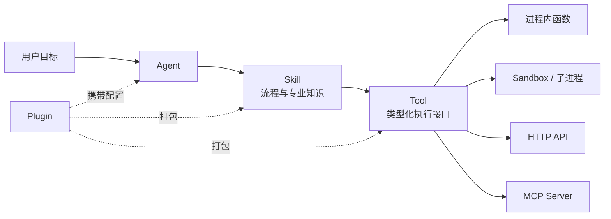

Skill、Tool、MCP 和 Plugin 存在交集，但并不等价：

- Skill 主要承载程序性知识和工作方法。
- Tool 承载可执行动作。
- MCP 规范连接和调用。
- Plugin 负责产品化打包和分发。
- Agent 根据上下文选择和组合它们。

### 4.3 领域对象关系

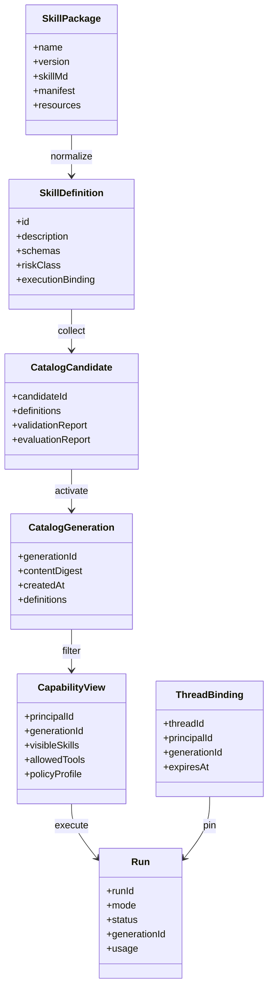

---

## 5. 系统上下文

### 5.1 参与者

| 参与者 | 主要职责 |
|---|---|
| Skill 作者 | 编写 `SKILL.md`、资源、脚本和执行绑定 |
| 平台管理员 | 配置来源、触发验证、审批和发布 |
| 普通用户 | 通过自然语言或 Direct API 使用能力 |
| 自动化客户端 | 通过类型化 Direct API 集成确定性能力 |
| 安全/合规人员 | 定义政策、审批高风险能力、审计运行记录 |
| 评测系统 | 验证 Skill 是否提升效果且没有回归 |
| 身份提供商 | 提供用户、角色、部门和租户身份 |
| 外部执行系统 | MCP Server、HTTP API、Sandbox、工作流平台 |

### 5.2 系统上下文图

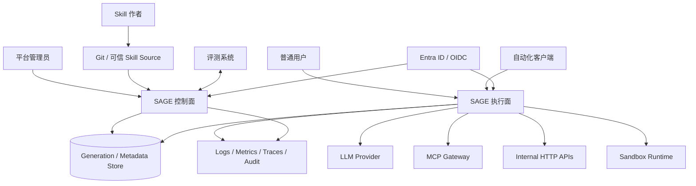

---

## 6. 总体架构

### 6.1 四个平面

SAGE 分为四个职责隔离的平面：

| 平面 | 目标 | 典型操作 |
|---|---|---|
| 控制面 | 把候选 Skills 安全发布为 Generation | 加载、验证、评测、构建、审批、激活、回滚 |
| 执行面 | 在固定 Generation 上执行请求 | 鉴权、路由、Agent、Direct、Tool、结果和 SSE |
| 学习面 | 从运行中提取改进信号 | 反馈、聚合、候选生成、回归评测、人工评审 |
| 基础设施面 | 提供持久化、安全和可观测能力 | 数据库、对象存储、Checkpointer、Vault、OTel |

### 6.2 总体模块图

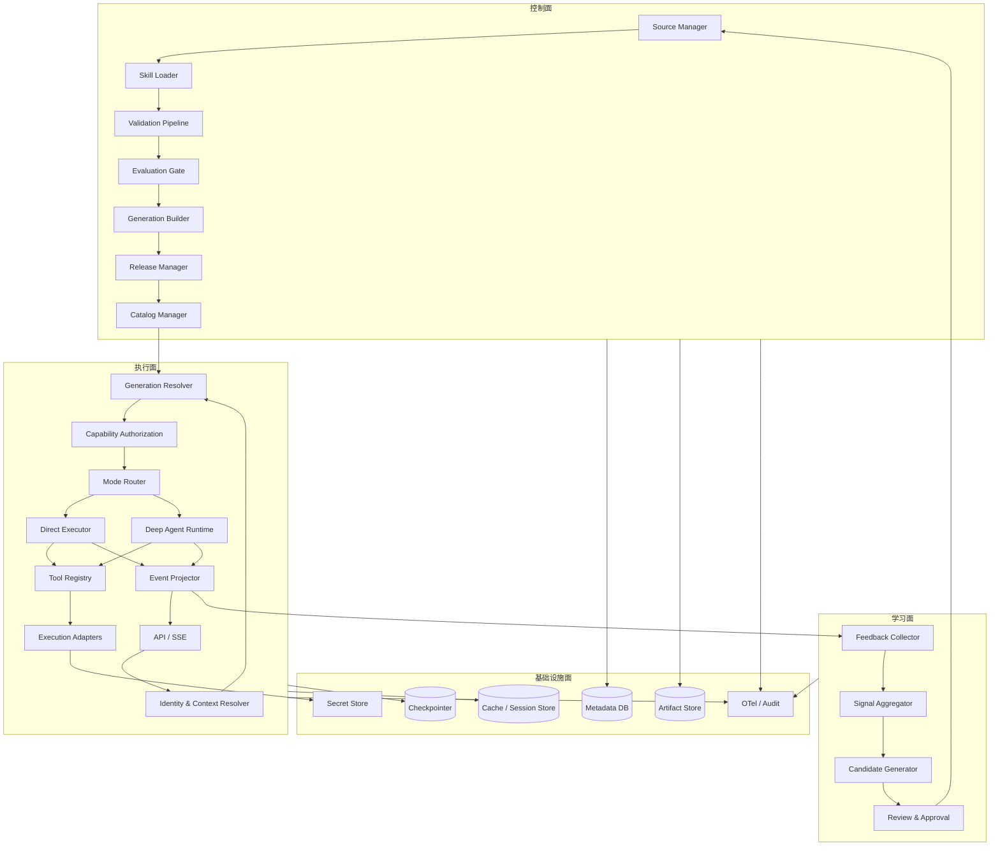

### 6.3 关键边界

- 控制面不能直接改变正在运行请求捕获的 Generation。
- 执行面不能写入生产 Skill 内容。
- 学习面只能生成 Candidate，不能自行激活。
- Skill 不能读取平台密钥；Adapter 代表平台注入凭据。
- Agent 只能看到 Capability View 中经过授权的 Tools。

---

## 7. Skill 包与执行契约

### 7.1 目录结构

```text
skills/
└── pii-redact/
    ├── SKILL.md
    ├── skill.yaml
    ├── scripts/
    │   └── redact.py
    ├── references/
    │   └── patterns.md
    ├── assets/
    │   └── output-template.json
    └── evals/
        ├── evals.json
        └── files/
```

### 7.2 `SKILL.md` 职责

`SKILL.md` 遵循 Agent Skills 标准，负责：

- 名称和激活描述
- 适用及不适用场景
- 标准操作流程
- 决策条件和边界
- 输入输出示例
- 对脚本、参考资料和模板的引用

它不负责存储：

- 密钥
- 实际 endpoint URL
- 用户权限
- 不可覆盖的企业政策
- 运行时资源上限

### 7.3 `skill.yaml` 职责

`skill.yaml` 是 SAGE 的最小执行绑定，不取代 Agent Skills 或 MDA。它负责把 Skill 连接到可强制执行的 Runtime Contract。

示例：

```yaml
apiVersion: sage.dev/v1alpha1
kind: SkillBinding

metadata:
  name: pii-redact
  version: 1.2.0

spec:
  execution:
    type: python-subprocess
    entrypoint: scripts/redact.py

  inputSchema:
    type: object
    required: [text]
    properties:
      text:
        type: string
        maxLength: 20000

  outputSchema:
    type: object
    required: [redacted_text, findings]
    properties:
      redacted_text:
        type: string
      findings:
        type: array

  policy:
    risk: read-only
    idempotent: true
    timeoutSeconds: 10
    maxOutputBytes: 65536
    network: deny
    filesystem: skill-root-read-only
    environmentAllowlist: []

  evaluation:
    required: true
    minimumPassRate: 0.95
    baselineRegressionTolerance: 0.0
```

### 7.4 执行类型

| 类型 | 用途 | 默认边界 |
|---|---|---|
| `prompt` | 纯流程与知识 Skill | 无直接执行器，只能组合已授权 Tools |
| `builtin-tool` | 平台内置、经过代码审查的 Tool | 可在进程内运行 |
| `python-subprocess` | 管理员可信的动态 Python Skill | 子进程隔离，不视为安全沙箱 |
| `http` | 内部或远程服务 | 仅使用 endpoint alias 和网络白名单 |
| `mcp` | MCP Server Tool | 通过受治理 MCP Gateway 调用 |
| `workflow` | 固定工作流或业务流程 | 通过工作流平台 Adapter 调用 |
| `sandbox` | 不可信或需要系统能力的脚本 | 容器、microVM 或托管 Sandbox |

### 7.5 风险分类

| 风险等级 | 示例 | 默认政策 |
|---|---|---|
| `read-only` | 查询、分析、格式转换 | 可自动执行，仍受预算约束 |
| `write-low` | 创建草稿、写入临时空间 | 要求幂等键和完整审计 |
| `write-high` | 修改业务数据、发送通知 | 默认人工审批 |
| `destructive` | 删除、部署、生产变更 | 强制审批、最小权限和独立审计 |
| `regulated` | 财务、医疗、合规决策 | 人工最终决策，不允许全自动闭环 |

---

## 8. Skill 共享与个性化架构

### 8.1 分层模型

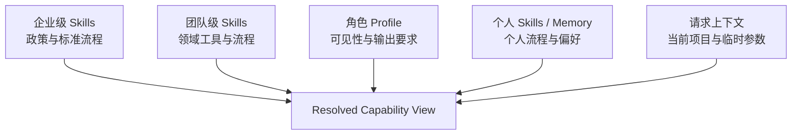

### 8.2 各层职责

| 层级 | 适合存放 | 是否共享 | 是否允许个人覆盖 |
|---|---|---|---|
| 企业 Skill | 合规、安全、通用 SOP | 全企业或指定组织 | 不允许降低安全约束 |
| 团队 Skill | 部门工具、领域知识、团队流程 | 团队成员 | 可扩展，不可绕过企业政策 |
| 角色 Profile | Tool 可见性、输出模板、审批等级 | 同角色 | 仅允许受控配置 |
| Personal Skill | 个人独有且可重复的工作流 | 默认个人 | 必须通过私有发布门禁 |
| User Memory | 语言、格式、偏好和历史事实 | 个人 | 用户可管理 |
| Request Context | 当前任务、项目、工单、截止时间 | 单次运行 | 请求结束后失效或按政策保留 |

### 8.3 合并规则

能力解析不是简单文本拼接，而是策略化求交集：

```text
可见 Skills = Generation 中的 Skills
             ∩ 租户允许范围
             ∩ 团队允许范围
             ∩ 角色允许范围
             ∩ 用户许可范围

最终执行政策 = 企业底线
             + Skill 声明
             + 角色限制
             + 请求级更严格限制
```

规则：

1. 下层只能收紧安全政策，不能放宽企业底线。
2. Personal Skill 不可覆盖同名企业 Skill；必须使用独立 namespace。
3. User Memory 不可改变 Tool 权限和网络政策。
4. Request Context 不进入共享 Skill 文件。
5. 同名 Skill 的覆盖必须显式、版本化并可审计，禁止隐式 last-write-wins。

### 8.4 何时创建 Personal Skill

适合创建 Personal Skill：

- 用户有稳定、重复、明显独特的工作流程
- 流程不包含共享企业政策的私有复制
- 该 Skill 仅访问用户已授权的 Tools
- 经过至少基础回归评测

不适合创建 Personal Skill：

- 只是语言、格式或详细程度偏好
- 只是当前项目的临时信息
- 试图绕过共享政策
- 仅因一次执行失败就复制并修改公共 Skill

### 8.5 Skill 是否每次执行后更新

**不会。** 每次执行产生的是 `LearningSignal`，例如：

- 成功或失败
- Tool 选择是否正确
- 用户评分和文字反馈
- 延迟、Token 与成本
- 输入分布变化
- 重复出现的错误模式

只有满足候选生成策略时，学习面才创建 Candidate。Candidate 必须经过评测和审批后才能成为新 Generation。

---

## 9. Agent 架构

### 9.1 统一的是什么

统一的是 Agent Runtime 和治理能力：

- API 和运行契约
- Agent Harness
- Tool 调用协议
- Generation 解析
- 鉴权与授权
- 预算、超时和取消
- 事件、错误和审计模型
- Memory 与 Checkpoint 接口

### 9.2 不统一的是什么

每个用户或场景可以不同：

- 可见 Skills
- 可调用 Tools
- 团队和角色政策
- User Memory
- Thread 历史
- 审批策略
- 模型 Profile
- 响应模板

### 9.3 Agent Definition

Agent 不是单一全能实例，而是统一 Runtime 上的受管定义：

```yaml
name: general-assistant
description: General team assistant for low-risk knowledge and analysis tasks
modelProfile: default-reasoning
skillSelectors:
  - risk in [read-only]
toolPolicy: standard-user
memoryPolicy: user-scoped
approvalPolicy: default
budgets:
  maxSteps: 20
  maxToolCalls: 20
  maxSubagents: 3
  timeoutSeconds: 120
```

### 9.4 统一 Agent 与多个命名 Agent

默认可提供一个通用 Agent，但下列情况应创建命名 Agent：

- 目标函数明显不同，例如客服、运维和财务
- 风险边界不同
- 允许的 Tools 明显不同
- 评测集和质量指标不同
- 需要不同模型或预算
- 需要独立审计和负责人

```text
统一 Runtime
├── general-assistant
├── support-agent
├── incident-agent
└── compliance-agent
```

### 9.5 Deep Agent 渐进加载

Agent 路径使用渐进披露：

1. 初始只加载可见 Skill 的名称和描述。
2. 模型识别相关 Skill 后读取完整 `SKILL.md`。
3. 仅在指令要求时读取 references 和 assets。
4. 可执行动作仍必须调用已授权 Tool。

### 9.6 Runtime Context

每次 Agent 执行传入不可变上下文：

```json
{
  "principal_id": "user-123",
  "tenant_id": "tenant-a",
  "team_ids": ["support"],
  "roles": ["analyst"],
  "generation_id": "gen-20260818-0042",
  "thread_id": "thr-opaque",
  "request_id": "req-opaque",
  "locale": "zh-CN",
  "deadline": "2026-08-18T12:00:00Z"
}
```

模型不能修改这些字段。

---

## 10. 控制面模块

### 10.1 Source Manager

**职责**

- 管理可信 Git、文件、Registry 或 Admin API 来源
- 记录来源身份、分支、Commit、签名和同步策略
- 拉取候选 Skill 包
- 防止来源混淆和未授权覆盖

**输入**：Source 配置、Git ref、管理员操作  
**输出**：只读候选文件树及来源证明

### 10.2 Skill Loader

**职责**

- 扫描 Skill 目录
- 解析 `SKILL.md` frontmatter
- 安全解析 `skill.yaml`
- 收集 scripts、references、assets 和 evals
- 拒绝符号链接逃逸、路径穿越和超大文件

**输出**：`SkillPackage[]`

### 10.3 Specification Validator

**职责**

- 调用 Agent Skills `skills-ref`
- 验证名称、目录、描述和文件结构
- 检查引用资源是否存在
- 检查 Skill 文档大小和编码

### 10.4 Execution Contract Validator

**职责**

- 验证 `skill.yaml` Schema
- 检查 Skill 名称和版本一致性
- 校验 JSON Input/Output Schema
- 检查 entrypoint、endpoint alias 和 Adapter 类型
- 验证幂等性、副作用、超时和资源上限

### 10.5 Security Scanner

**职责**

- 扫描命令、网络、凭据和文件系统使用信号
- 验证 endpoint allowlist
- 检查二进制、符号链接和危险脚本
- 验证包摘要和可选签名
- 生成风险报告，不把静态扫描结果描述为安全证明

### 10.6 Policy Compiler

**职责**

- 合并企业政策、Skill 声明和风险分类
- 生成 Runtime 可直接执行的 Policy Profile
- 确保下层政策不能降低企业底线

### 10.7 Evaluation Gate

**职责**

- 运行 Skill 自带 evals
- 比较 `with_skill` 与 baseline
- 验证 Tool Call 断言
- 检查新旧版本行为回归
- 输出通过、失败或需人工复核

优先集成 `agent-skills-eval`，SAGE 只负责门禁策略和结果归一化。

### 10.8 Generation Builder

**职责**

- 将通过门禁的 SkillDefinition 构建为不可变快照
- 计算内容摘要
- 生成 Tool Definitions
- 构建只读 Skill Backend
- 编译 Agent Definitions 和 Capability Index
- 生成 SBOM、来源和评测报告引用

### 10.9 Release Manager

**职责**

- 管理 Candidate 生命周期
- 串行化同一 Catalog 的发布
- 请求人工审批
- 激活或拒绝 Candidate
- 触发显式回滚

### 10.10 Catalog Manager

**职责**

- 提供 Active Generation
- 管理历史 Generation
- 为请求和线程提供引用
- 维护引用计数和保留策略
- 回收不再被请求或线程使用的旧 Generation

### 10.11 Admin API

**职责**

- 提交和查询 Candidate
- 查看验证及评测报告
- 激活、回滚和退役 Generation
- 查询 Catalog 差异
- 管理来源和发布策略

---

## 11. 执行面模块

### 11.1 API Gateway / Transport

**职责**

- REST 请求接入
- SSE 流式响应
- 请求大小、Content-Type 和速率限制
- Request ID 和 Trace Context 生成
- 同步错误到 Problem Details 映射

### 11.2 Authentication

**职责**

- MVP：用户 API Key 与独立管理员 API Key
- 生产：OIDC、Entra ID、JWT、Service Principal
- 输出标准 `Principal`

### 11.3 Identity and Context Resolver

**职责**

- 解析用户、租户、团队和角色
- 加载 User Profile 和 Memory Policy
- 生成不可变 Runtime Context
- 校验 Thread 所有权

### 11.4 Generation Resolver

**职责**

- 新 Thread 捕获当前 Active Generation
- 已存在 Thread 读取原有 Generation Binding
- Direct 无 Thread 请求捕获当前 Active Generation
- 拒绝已回收或无权限的 Generation 引用

### 11.5 Capability View Resolver

**职责**

- 根据身份和 Generation 过滤 Skills
- 计算 Allowed Tools
- 合并角色和请求级限制
- 提供 Agent 可见元数据
- 保证个人化不会扩大权限

### 11.6 Mode Router

支持三种模式：

| 模式 | 行为 | 是否使用 LLM |
|---|---|---|
| `skill` | 明确调用某个 Skill/Tool | 否 |
| `agent` | 调用指定命名 Agent | 是 |
| `auto` | 使用默认 Agent 自动发现和组合 | 是 |

### 11.7 Direct Executor

**职责**

- 解析指定 Skill 和可选版本
- 检查 Capability View
- 校验输入 Schema
- 调用 Adapter
- 校验输出 Schema
- 返回 `model_calls: 0`

### 11.8 Agent Runtime

**职责**

- 创建或获取 Generation 对应的 Deep Agent
- 注入 Runtime Context、Skill Backend 和 Tools
- 执行渐进 Skill 加载
- 管理 Tool 和 Subagent 调用
- 遵守统一预算和取消信号

### 11.9 Tool Registry and Factory

**职责**

- 从 SkillDefinition 生成类型化 Tool
- 保持 Tool 名称稳定
- 将 Tool 调用绑定到当前 Generation Adapter
- 防止运行期间切换到新版本

### 11.10 Policy Enforcement Point

**职责**

- 在每次 Tool 调用前检查身份和风险政策
- 检查审批状态、预算、截止时间和幂等键
- 注入最小凭据引用
- 记录允许或拒绝原因

### 11.11 Budget Manager

统一限制：

- 总运行时间
- Agent 图步骤数
- Tool 调用次数
- Subagent 数量
- 模型 Token 和成本
- 输入输出字节数
- 并发数

### 11.12 Session Manager

**职责**

- Thread 创建、续期、删除和所有权校验
- Generation Binding
- Checkpoint 生命周期
- TTL 和容量治理

### 11.13 Event Projector

将框架内部事件转换为稳定的应用事件：

```text
run.started
skill.loaded
tool.started
tool.completed
subagent.started
subagent.completed
approval.required
message.delta
run.completed
run.failed
```

不得输出：

- Chain-of-thought
- 模型私有 reasoning
- 密钥或 Authorization Header
- 未脱敏 Tool 参数与结果
- Provider 专用内部对象

### 11.14 Result Normalizer

统一返回：

- 状态和最终结果
- Generation ID
- Request/Run/Thread ID
- 使用的 Skills 和 Tools
- 模型与 Token 使用量
- 执行耗时
- 警告和标准错误码

---

## 12. Adapter 与执行环境

### 12.1 统一 Adapter 接口

```python
class SkillAdapter(Protocol):
    async def execute(
        self,
        definition: SkillDefinition,
        arguments: dict,
        context: RuntimeContext,
        cancellation: CancellationToken,
    ) -> SkillResult: ...
```

所有 Adapter 必须：

- 接受结构化输入
- 支持截止时间和取消
- 返回结构化结果或标准错误
- 执行输出大小限制
- 不直接返回凭据和内部异常栈
- 记录 Trace 和审计元数据

### 12.2 In-Process Adapter

仅用于平台维护、经过代码审查的内置 Tools。

优点：低延迟。  
风险：故障会影响 Web 进程。  
原则：动态 Skill 不允许被直接 import 进 API 进程。

### 12.3 Subprocess Adapter

用于管理员可信 Python 或命令行 Skill。

约束：

- JSON stdin/stdout 契约
- 固定可执行文件和工作目录
- 禁止 shell 字符串拼接
- 环境变量默认清空，只允许白名单
- 超时后终止整个进程树
- stdout/stderr 和文件大小限制
- Windows Job Object 或等价进程树管理

注意：Subprocess 不是安全 Sandbox。

### 12.4 HTTP Adapter

约束：

- 只接受服务器配置的 endpoint alias
- HTTPS 和主机 allowlist
- DNS rebinding 与 SSRF 防护
- 禁止不安全重定向
- Connect、Read、Write 和 Pool Timeout
- 连接池和并发限制
- 仅幂等请求允许自动重试
- 响应大小和 Schema 校验

### 12.5 MCP Adapter

生产环境优先通过 ToolHive、Microsoft MCP Gateway 或 ContextForge：

- Tool 发现和版本引用
- 用户授权和凭据代理
- MCP Server 生命周期
- 容器或 Kubernetes 隔离
- 统一审计和 OTel

SAGE 只保存 MCP Tool 的稳定引用和 Generation 绑定。

### 12.6 Sandbox Adapter

用于不可信脚本或需要系统能力的 Agent：

- 每 Thread 或每 Run 独立 Sandbox
- 默认禁止网络
- 不把平台密钥放入 Sandbox
- 通过宿主 Tool 或认证代理访问受保护系统
- 设置 CPU、内存、磁盘、进程和 TTL 限制
- Sandbox 输出视为不可信输入

---

## 13. 学习与 Skill 改进面

### 13.1 为什么独立成面

运行时可靠性要求生产 Skill 不可变；持续改进要求系统能从反馈学习。这两个目标必须通过 Candidate 边界解耦。

### 13.2 学习闭环

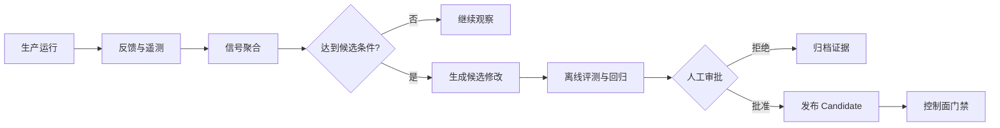

### 13.3 Learning Signal

```json
{
  "run_id": "run-123",
  "generation_id": "gen-42",
  "skill_id": "support/brief-maker@1.2.0",
  "signal_type": "user_correction",
  "severity": "medium",
  "redacted_evidence_ref": "artifact://signals/abc",
  "created_at": "2026-08-18T10:00:00Z"
}
```

### 13.4 Candidate 触发条件

- 同类失败超过阈值
- 用户纠正重复出现
- 业务政策发生变化
- Tool 或 API 契约更新
- 评测集新增关键场景
- 成本或延迟持续退化
- Skill 描述导致路由错误

### 13.5 Candidate Generator

可以由人、Agent 或 SkillHone 生成候选修改，但必须满足：

- 修改落入独立分支或 Candidate 目录
- 保留来源和修改原因
- 不访问未脱敏生产数据
- 不读取保密评测 Gold Label
- 不直接激活生产 Generation

### 13.6 Personal Memory 更新

User Memory 可以采用更轻量的更新流程，但仍要：

- 限定用户作用域
- 允许用户查看和删除
- 禁止写入企业共享 Memory
- 禁止保存密钥和高敏感原文
- 与 Skill 发布分开

---

## 14. 核心时序

### 14.1 Skill 发布

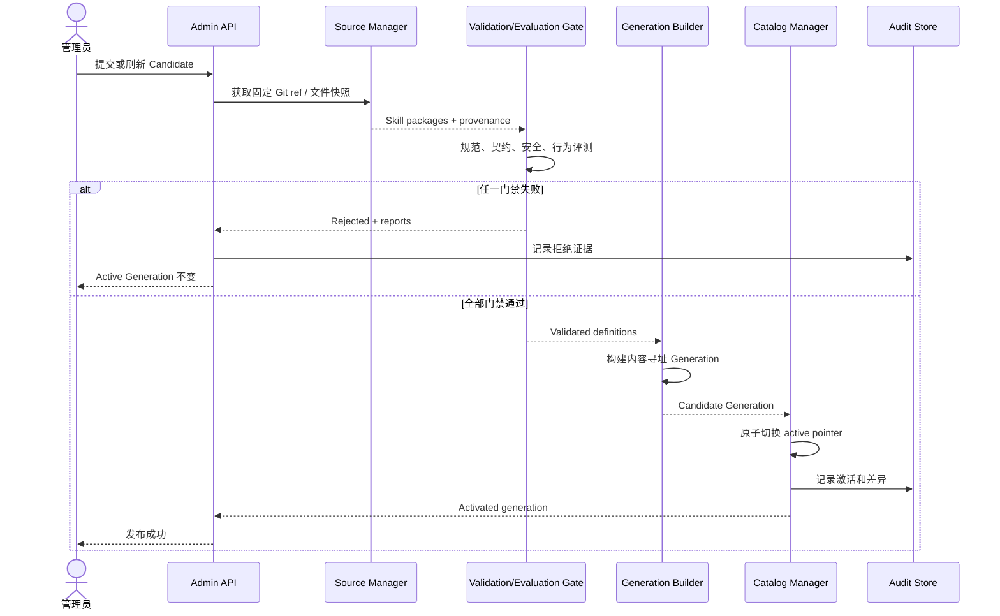

### 14.2 Direct Skill 执行

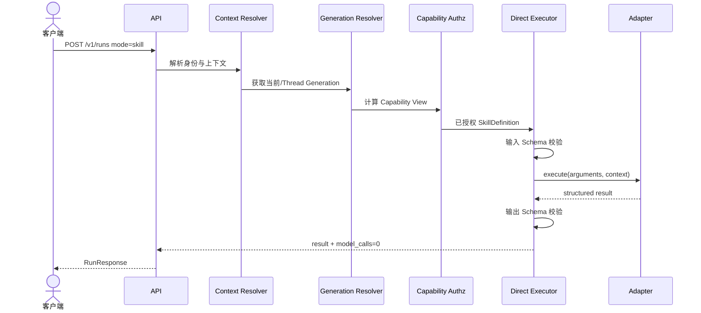

### 14.3 Auto Agent 执行

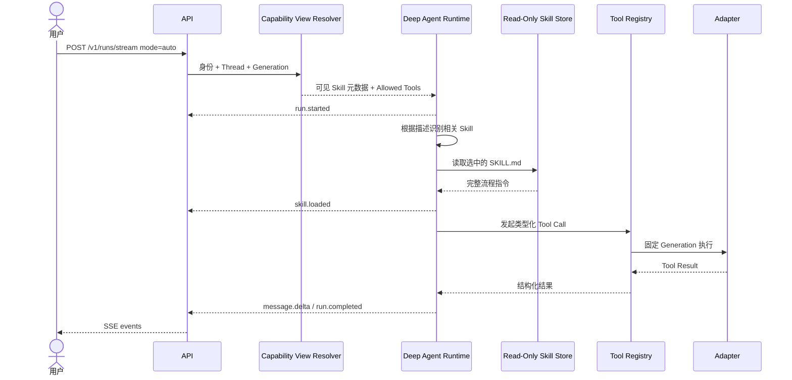

### 14.4 发布期间的版本一致性

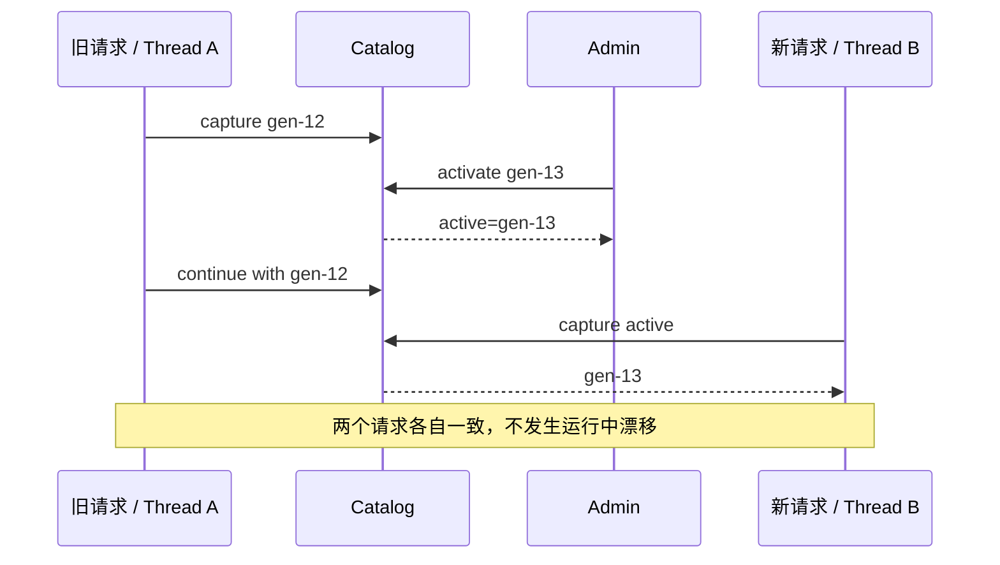

### 14.5 执行反馈到新版本

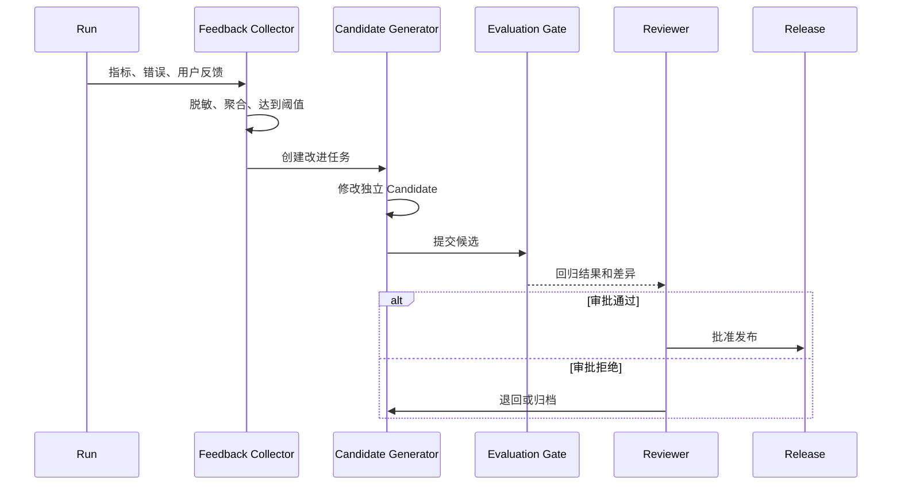

---

## 15. API 架构

### 15.1 用户 API

| Method | Path | 说明 |
|---|---|---|
| `GET` | `/health/live` | 进程存活，不执行外部依赖 |
| `GET` | `/health/ready` | Catalog、执行 Provider 与 Runner 就绪状态；Runner 不可达或 profile 不匹配返回 `503` |
| `GET` | `/v1/targets` | 当前用户在固定 Generation 中可见的 Skills/Agents |
| `POST` | `/v1/runs` | 同步 Direct 或 Agent 执行 |
| `POST` | `/v1/runs/stream` | POST SSE 流式执行 |
| `DELETE` | `/v1/threads/{thread_id}` | 删除当前用户 Thread 和 Binding |
| `POST` | `/v1/runs/{run_id}/feedback` | 提交评分、纠正或问题反馈 |

### 15.2 管理 API

| Method | Path | 说明 |
|---|---|---|
| `GET` | `/v1/admin/status` | 控制面状态和 active Generation |
| `GET/POST/PUT` | `/v1/admin/agents...` | Agent 草稿创建、编辑、克隆和验证 |
| `GET/POST` | `/v1/admin/skills...` | Skill ZIP 上传、验证和双制品下载 |
| `GET/POST/PUT` | `/v1/admin/mcp...` | MCP 配置、测试、发现和 Tool 导入 |
| `POST` | `/v1/admin/candidates` | 创建统一 Candidate |
| `POST` | `/v1/admin/candidates/{id}/validate` | 运行结构、安全和评测门禁 |
| `GET` | `/v1/admin/candidates/{id}` | 查询报告与状态 |
| `POST` | `/v1/admin/candidates/{id}/activate` | 激活通过审批的 Generation |
| `GET` | `/v1/admin/generations` | 查询历史 Generation |
| `GET` | `/v1/admin/generations/{id}/diff` | 查询 Generation 差异 |
| `GET` | `/v1/admin/approvals` | 查询审批队列 |
| `POST` | `/v1/admin/approvals/{id}/approve|reject` | 带理由审批或拒绝 |
| `POST` | `/v1/admin/generations/{id}/rollback-request` | 创建回滚审批 |
| `POST` | `/v1/admin/approvals/{id}/rollback` | 执行已审批回滚 |

### 15.3 RunRequest

```json
{
  "mode": "auto",
  "message": "请处理这批客户反馈并生成行动摘要",
  "thread_id": "thr-optional",
  "metadata": {
    "project_id": "feedback-demo"
  }
}
```

Direct 示例：

```json
{
  "mode": "skill",
  "target": "pii-redact",
  "arguments": {
    "text": "Contact alice@example.com"
  }
}
```

### 15.4 RunResponse

```json
{
  "run_id": "run-123",
  "request_id": "req-123",
  "thread_id": null,
  "generation_id": "gen-42",
  "status": "completed",
  "result": {
    "redacted_text": "Contact [EMAIL]"
  },
  "usage": {
    "model_calls": 0,
    "tool_calls": 1,
    "input_tokens": 0,
    "output_tokens": 0,
    "duration_ms": 31
  }
}
```

### 15.5 稳定错误模型

| 错误码 | 含义 |
|---|---|
| `invalid_request` | API 请求不符合契约 |
| `target_not_found` | Generation 中不存在目标 |
| `target_not_allowed` | 当前用户无权查看或执行 |
| `generation_unavailable` | Thread 绑定版本已不可用 |
| `model_unavailable` | Agent 模式缺少模型配置 |
| `schema_validation_failed` | 输入或输出 Schema 失败 |
| `policy_denied` | 平台政策拒绝执行 |
| `approval_required` | 需要人工批准 |
| `budget_exceeded` | 步骤、Tool、Token 或成本超限 |
| `timeout` | 总运行或 Adapter 超时 |
| `cancelled` | 客户端或系统取消 |
| `dependency_unavailable` | HTTP/MCP/Sandbox 依赖失败 |
| `execution_failed` | Skill 执行失败 |

---

## 16. 数据与存储架构

### 16.1 数据分类

| 数据 | 推荐存储 | 生命周期 |
|---|---|---|
| Skill 源文件 | Git / Artifact Store | 长期、版本化 |
| Generation Metadata | 当前原子 JSON；目标 PostgreSQL | 长期 |
| Generation Artifact | 当前本地 `.sage-state/generations`；目标 Object Store | 不可变、按保留策略 |
| Active Pointer | 当前原子 JSON；目标 PostgreSQL / 强一致 KV | 长期、原子更新 |
| Thread Checkpoint | LangGraph Checkpointer | TTL 或业务策略 |
| User Memory | 用户隔离 Store | 用户可管理 |
| Runtime Cache | Redis | 短期 |
| SSE Event | 当前进程内 RunStore；生产 PostgreSQL Event Store | 按重放需求 |
| Audit Record | 专用审计存储 / SIEM | 合规保留 |
| Metrics/Traces | OTel Backend | 运营策略 |
| Secrets | Vault / Key Vault | 不进入普通数据库 |

### 16.2 Generation Artifact

Generation 应包含：

- `generation.json`
- SkillDefinition 索引
- 规范化 `SKILL.md` 和资源
- Policy Profiles
- Tool Definitions
- Agent Definitions
- 内容摘要清单
- 来源证明
- 验证报告引用
- 评测报告引用
- 可选签名和 SBOM

### 16.3 多租户隔离

- 所有主键带 `tenant_id` 或使用独立 namespace。
- Thread、Memory、Catalog View 和 Audit 均绑定 Principal/Tenant。
- Object Store 路径和加密密钥按租户隔离。
- 任何跨租户 Skill 分享必须显式审批。

---

## 17. 一致性与可靠性

### 17.1 原子激活

发布过程不逐个覆盖 Skill。Generation 完整构建后，只更新 Active Pointer：

```text
active_generation: gen-12 -> gen-13
```

更新必须使用事务或 Compare-And-Swap。

### 17.2 请求固定

请求进入后立即获得 `GenerationLease`：

- Lease 持有 Generation 引用。
- 运行结束后释放。
- 有活动 Lease 的 Generation 不可删除。

### 17.3 Thread 固定

- 新 Thread 绑定 Active Generation。
- 后续消息继续使用原绑定。
- 用户可显式创建新 Thread 采用最新 Generation。
- 生产系统可提供受控 Migration，而非静默升级。

### 17.4 回滚

回滚只切换 Active Pointer，不修改旧 Artifact。

```text
gen-13 发生问题 -> active pointer 回到 gen-12
```

已经捕获 gen-13 的请求可按风险策略：

- 默认完成当前执行
- 高危故障时统一取消
- 绝不在运行中无声切换到 gen-12

### 17.5 重试

| 操作 | 默认重试策略 |
|---|---|
| 模型暂时性失败 | 有界指数退避 |
| 只读幂等 HTTP/MCP | 有界重试 |
| 写操作且有幂等键 | 按声明重试 |
| 未声明幂等的副作用操作 | 不自动重试 |
| 发布激活 CAS 冲突 | 重新读取后人工或有界重试 |

### 17.6 背压与熔断

- 进程级和租户级并发信号量
- Adapter 连接池上限
- 模型和依赖速率限制
- Queue wait timeout
- 依赖熔断器
- 预算提前拒绝

---

## 18. 安全架构

### 18.1 信任边界

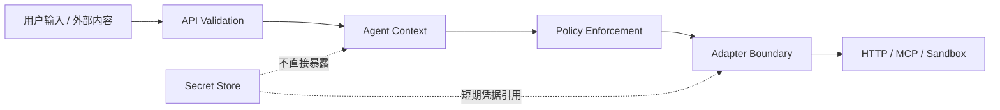

### 18.2 主要威胁与控制

| 威胁 | 主要控制 |
|---|---|
| Prompt Injection | Tool 白名单、只读 Skill、内容分层、结果不可信处理 |
| 越权 Tool 调用 | 身份化 Capability View、调用前 Policy Enforcement |
| SSRF | endpoint alias、DNS/IP 检查、网络 allowlist、禁止重定向 |
| 密钥泄露 | Vault、Adapter 注入、日志脱敏、Sandbox 无密钥 |
| 恶意 Skill 包 | 可信来源、签名、扫描、评测、Sandbox |
| 路径穿越 | 虚拟路径、禁止 `..` 和绝对路径、符号链接检查 |
| 资源耗尽 | 输入输出上限、超时、并发和预算 |
| 供应链污染 | Commit 固定、内容摘要、签名、SBOM、审批 |
| Shared Memory 污染 | 用户/租户隔离、共享 Memory 只读、写入审批 |
| 审批绕过 | 高风险分类由平台强制，不接受 Prompt 覆盖 |
| 推理泄露 | SSE 不输出 Chain-of-thought 和私有 reasoning |

### 18.3 Human-in-the-loop

审批记录必须包含：

- Run、Principal 和 Generation
- Tool 名称和风险等级
- 脱敏参数摘要
- 预期副作用
- Approve、Reject 或 Edit 决策
- 审批人和时间

审批结果应通过 Checkpoint 恢复同一执行，而不是重新运行整个任务。

### 18.4 数据隐私

- 默认不记录完整 Prompt、Tool 参数和结果。
- 使用引用保存必要证据，并实施访问控制。
- 支持 PII 检测和流式输出脱敏。
- 明确数据驻留和保留政策。
- 用户可删除自己的 Memory 和 Thread。

---

## 19. 可观测性与审计

### 19.1 三类记录

| 类型 | 用途 | 是否可包含业务内容 |
|---|---|---|
| Operational Log | 排障和服务状态 | 默认不包含 |
| Telemetry | 指标和 Trace | 仅脱敏标签 |
| Audit Record | 谁在何时做了什么 | 仅必要摘要和证据引用 |

### 19.2 关键指标

**运行指标**

- Direct/Agent 请求量和成功率
- P50/P95/P99 延迟
- Tool/Skill 选择次数
- Token 和模型成本
- Budget Exceeded、Timeout、Cancellation
- 每 Adapter 错误率和熔断状态

**发布指标**

- Candidate 通过率
- 验证和评测耗时
- Generation 激活次数
- 回滚次数和原因
- 新旧版本质量差异

**治理指标**

- 未授权调用拒绝数
- 高风险审批数和拒绝率
- 过期 Skill 数量
- 无 Owner 或无 Eval 的 Skill 数量

### 19.3 Trace 层级

```text
HTTP Request Span
└── Run Span
    ├── Agent Step Span
    ├── Skill Load Span
    ├── Tool Call Span
    │   └── Adapter Span
    └── Result Normalization Span
```

### 19.4 SLO 示例

生产化后可定义：

- Direct 只读 Skill 可用性 ≥ 99.9%
- Agent API 可用性 ≥ 99.5%
- 失败发布不得改变 Active Generation
- 100% Run 可关联 Generation ID
- 100% 高风险 Tool Call 有审批或明确拒绝记录

---

## 20. 部署架构

### 20.1 Hackathon MVP

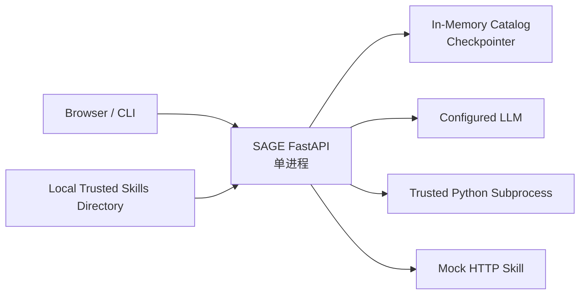

MVP 特征：

- 单进程单 Worker
- 内存 Generation 和 Thread
- 管理员手动刷新
- 可信本地 Skill 目录
- Fake Model 和 MockTransport 离线测试
- 无生产多租户声明

### 20.2 企业目标部署

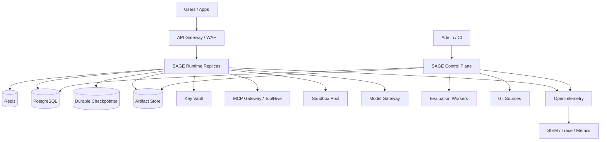

### 20.3 水平扩展要求

- Active Pointer 存储必须强一致。
- Generation Artifact 必须不可变且所有实例可读。
- Thread Checkpointer 必须共享。
- 发布锁必须分布式。
- Generation Lease 需要分布式引用或安全保留窗口。
- SSE 请求必须支持负载均衡器长连接配置。
- Sandbox 与请求实例解耦。

---

## 21. 技术选型与生态复用

| 架构能力 | MVP 技术 | 企业可选技术 |
|---|---|---|
| Web API | FastAPI + Pydantic | FastAPI / ASP.NET Core / 企业 API Gateway |
| Agent Harness | LangChain Deep Agents | Deep Agents / Microsoft Agent Framework / 自定义 LangGraph |
| Agent Runtime | LangGraph | LangGraph Deployment / Durable Agent Runtime |
| Skill 规范 | Agent Skills | Agent Skills + MDA 信任扩展 |
| Skill 验证 | `skills-ref` | CI + 签名 + 企业 Policy Engine |
| 行为评测 | Fake Model / pytest | agent-skills-eval + 企业评测平台 |
| MCP | 简化 Adapter | ToolHive / Microsoft MCP Gateway / ContextForge |
| HTTP | HTTPX | Service Mesh / API Gateway |
| Python 执行 | `asyncio` Subprocess | Container / gVisor / Firecracker / Managed Sandbox |
| Checkpointer | InMemorySaver | PostgreSQL/Redis 支持的持久 Checkpointer |
| Catalog | 内存不可变对象 | PostgreSQL + Object Store |
| 身份 | API Key | Entra ID / OIDC / Workload Identity |
| Secrets | 环境变量仅供本地 | Key Vault / Vault |
| Observability | Structured Log | OpenTelemetry + SIEM |
| Skill 改进 | 手工 Candidate | SkillHone 或企业改进 Agent |

### 21.1 框架替换边界

为了避免绑定 Deep Agents，SAGE 只依赖以下抽象：

- `AgentRuntime`
- `SkillKnowledgeBackend`
- `ToolDefinition`
- `Checkpointer`
- `EventStream`
- `ExecutionAdapter`

更换 Agent Framework 不应改变 Candidate、Generation、Pin 和 Rollback 模型。

---

## 22. 建议代码模块

```text
src/sage/
├── app.py
├── config.py
├── api/
│   ├── auth.py
│   ├── health.py
│   ├── runs.py
│   ├── threads.py
│   ├── feedback.py
│   └── admin.py
├── domain/
│   ├── skills.py
│   ├── catalog.py
│   ├── generation.py
│   ├── identity.py
│   ├── policies.py
│   ├── runs.py
│   └── events.py
├── control/
│   ├── sources.py
│   ├── loader.py
│   ├── validation.py
│   ├── security_scan.py
│   ├── evaluation.py
│   ├── builder.py
│   ├── release.py
│   └── catalog_manager.py
├── runtime/
│   ├── context.py
│   ├── capability_view.py
│   ├── router.py
│   ├── direct.py
│   ├── agents.py
│   ├── tools.py
│   ├── budgets.py
│   ├── sessions.py
│   ├── approvals.py
│   ├── event_projector.py
│   └── result_normalizer.py
├── adapters/
│   ├── base.py
│   ├── builtin.py
│   ├── subprocess.py
│   ├── http.py
│   ├── mcp.py
│   ├── workflow.py
│   └── sandbox.py
├── learning/
│   ├── feedback.py
│   ├── signals.py
│   ├── candidate_generator.py
│   └── review.py
├── storage/
│   ├── metadata.py
│   ├── artifacts.py
│   ├── checkpoints.py
│   ├── memory.py
│   └── audit.py
└── observability/
    ├── logging.py
    ├── metrics.py
    └── tracing.py
```

### 22.1 模块职责矩阵

| 模块 | 关键输入 | 关键输出 | 不负责 |
|---|---|---|---|
| `loader` | 可信文件快照 | SkillPackage | 激活生产版本 |
| `validation` | SkillPackage | ValidationReport | 运行用户请求 |
| `evaluation` | Candidate + Evals | EvaluationReport | 自动批准发布 |
| `builder` | 通过门禁的 Definitions | Generation Artifact | 修改 Active Pointer |
| `release` | Candidate + Approval | 激活/拒绝结果 | 执行 Tool |
| `catalog_manager` | Generation | Lease/Binding | Agent 推理 |
| `capability_view` | Principal + Generation | 可见 Skills/Tools | 修改企业权限 |
| `router` | RunRequest | Direct/Agent 路径 | 业务执行 |
| `direct` | Skill + Arguments | SkillResult | 模型推理 |
| `agents` | Context + Capability View | Agent Result/Events | 绕过授权 |
| `adapters` | Tool Call | Execution Result | 选择 Tool |
| `feedback` | Run 结果与用户反馈 | LearningSignal | 修改生产 Skill |

---

## 23. 测试与质量体系

### 23.1 测试金字塔

**单元测试**

- Manifest 和 Schema
- Policy 合并
- Capability View
- Generation Digest
- 错误映射

**契约测试**

- Subprocess JSON 协议
- HTTP Skill 协议
- MCP Tool 协议
- SSE Event Schema
- Storage 接口

**集成测试**

- Candidate 到 Activation
- Direct 执行
- Agent Skill 激活
- Thread Generation Pinning
- 回滚和旧 Generation 回收

**安全测试**

- 路径穿越和符号链接
- SSRF 和重定向
- 未授权 Tool
- Prompt Injection 尝试
- Secret/Reasoning 泄露
- 资源耗尽

**行为评测**

- Skill 路由正确率
- With/Without Skill 对照
- Tool Call 断言
- 新旧版本回归
- 成本与延迟变化

### 23.2 发布门禁顺序

```text
Format
-> Structure
-> Schema
-> Security Scan
-> Unit/Contract Tests
-> Behavioral Evaluation
-> Regression Comparison
-> Human Approval when required
-> Build Generation
-> Atomic Activate
```

### 23.3 必须验证的不变量

1. 失败 Candidate 不改变 Active Generation。
2. 同一 Run 的 Generation 不发生变化。
3. 同一 Thread 默认不发生静默升级。
4. Direct 模式的 `model_calls` 永远为 0。
5. Agent 不可调用 Capability View 外的 Tool。
6. 生产 Skill Store 对 Agent 只读。
7. Learning Plane 不可直接激活 Generation。
8. 高风险 Tool 未审批时不可执行。
9. 日志和 SSE 不包含密钥或 Chain-of-thought。

---

## 24. 关键架构决策

### ADR-001：使用 Agent Skills 标准

**决策：** `SKILL.md` 遵循 Agent Skills，不自创基础格式。  
**原因：** 获得跨 Runtime 兼容性和现成验证工具。

### ADR-002：使用最小执行绑定

**决策：** 使用 `skill.yaml` 表达 Runtime Contract。  
**原因：** Agent Skills 的自然语言内容不足以强制 Schema、超时和副作用政策。  
**约束：** 避免复制 MDA 已覆盖的签名、依赖和关系元数据。

### ADR-003：Direct 与 Agent 双路径

**决策：** 已知目标绕过 LLM。  
**原因：** 降低成本、延迟和不确定性。

### ADR-004：不可变 Generation

**决策：** Skill 不原地热改，完整 Candidate 原子激活。  
**原因：** 保证一致性、可复现和可回滚。

### ADR-005：执行与学习分离

**决策：** 每次执行只产生信号，不能改生产 Skill。  
**原因：** 防止漂移、污染和审计缺失。

### ADR-006：统一 Runtime，动态 Capability View

**决策：** 不为每个用户复制 Agent。  
**原因：** 统一治理，同时支持用户、团队和角色差异。

### ADR-007：多个命名 Agent 支持风险域隔离

**决策：** 通用 Runtime 可以承载多个 AgentDefinition。  
**原因：** 客服、运维和合规不能共享完全相同的目标、Tools 和风险政策。

### ADR-008：动态代码不进入 API 进程

**决策：** 动态 Python 使用 Subprocess，生产使用 Sandbox。  
**原因：** 限制故障范围并为安全隔离留出演进路径。

### ADR-009：SSE 使用应用自有事件协议

**决策：** 不直接暴露框架原始事件。  
**原因：** 保持客户端稳定并控制敏感信息。

### ADR-010：MCP 是 Adapter，不是 SAGE 核心协议

**决策：** REST/SSE 是初始用户 API，MCP 用于 Tool 执行与未来互操作。  
**原因：** 避免把发布治理绑定到单一传输协议。

---

## 25. 实施路线

### 阶段 0：架构验证

- 固定领域模型和 API 契约
- 创建两个可执行 Skills 和一个 Prompt Skill
- 验证 Agent Skills 与 Deep Agents 版本
- 用 Fake Model 验证渐进加载

### 阶段 1：Hackathon P0

- Loader 与 Manifest Validator
- 内存 Catalog Generation
- Direct Skill
- Auto Deep Agent
- Python/内置 Tool Adapter
- SSE
- 原子刷新和失败回滚
- 英雄案例

### 阶段 2：Hackathon P1

- HTTP/MCP Adapter 示例
- Generation 可视化
- Budget 和 Cancellation
- agent-skills-eval 发布门禁
- 请求和 Thread Pinning
- 真实指标

### 阶段 3：团队试点

- OIDC/Entra ID
- PostgreSQL 与持久 Checkpointer
- Git Candidate 和审批
- 团队/角色 Capability View
- Audit 和 OTel
- 容器 Sandbox

### 阶段 4：企业化

- 多租户和高可用
- ToolHive/ContextForge/Microsoft MCP Gateway 集成
- 持久任务与 Event Replay
- 签名、SBOM 和供应链政策
- Human-in-the-loop
- 成本配额与计量
- SkillHone 持续改进

---

## 26. 风险与开放问题

### 26.1 主要风险

| 风险 | 影响 | 缓解措施 |
|---|---|---|
| 范围过宽 | 变成小型 Dify/ToolHive | 聚焦 Candidate、Generation、Pin、Rollback |
| 自定义 Manifest 过重 | 与现有标准重复 | 保持最小执行绑定，评估 MDA 兼容 |
| Agent 路由错误 | 结果不可靠 | 描述质量、路由评测、命名 Agent |
| Skill 数量过多 | 元数据上下文仍膨胀 | 预过滤、语义搜索、领域 Catalog |
| 旧 Generation 长期占用 | 存储和内存增长 | TTL、引用计数、保留策略 |
| 个人化导致政策分叉 | 治理失控 | Profile/Memory 分离、下层只可收紧 |
| 反馈污染 | 错误改进进入 Candidate | 脱敏、聚合、评测和人工审批 |
| Subprocess 被误认为安全 | 企业风险 | 明确边界并迁移至 Sandbox |

### 26.2 待团队决策

- `skill.yaml` 是每个 Skill 必需，还是 Catalog 侧可生成默认绑定？
- Prompt-only Skill 是否允许不带执行 Manifest？
- Thread 默认固定 Generation 多久？
- 用户如何主动升级 Thread？
- Personal Skill 是否进入独立私有 Generation？
- 行为评测失败是否允许管理员强制发布？
- 哪些风险等级必须双人审批？
- 是否在 MVP 中实现 MCP，还是只保留 Adapter 接口？
- Catalog 的发布单元是全租户，还是按领域拆分？
- 哪些运行内容允许进入改进证据？

---

## 27. 架构验收标准

完成 MVP 后，必须能够证明：

- [ ] 标准 Agent Skill 可以被加载和验证。
- [ ] 不合法的 Skill 或执行绑定无法进入 Candidate。
- [ ] Candidate 失败不会改变 Active Generation。
- [ ] Direct Skill 执行不调用模型。
- [ ] Auto Agent 只读取相关 `SKILL.md`。
- [ ] Agent 只能看到当前用户被授权的 Tools。
- [ ] 旧请求在新 Generation 激活后继续使用旧版本。
- [ ] 新请求使用新 Generation。
- [ ] 同一 Thread 不发生静默版本漂移。
- [ ] 客户端断开会取消 Agent 和 Adapter 工作。
- [ ] 超时、预算耗尽和依赖失败具有稳定错误码。
- [ ] SSE 只有一个终止事件且不泄露 reasoning 或密钥。
- [ ] 每次运行都能关联 Principal、Generation、Skills、Tools 和 Audit Record。
- [ ] 每次执行反馈只产生 Learning Signal，不直接修改生产 Skill。
- [ ] 新 Skill 候选经过评测和审批后才能激活。

---

## 28. 术语表

| 术语 | 含义 |
|---|---|
| Active Generation | 新请求默认捕获的当前生产 Catalog 版本 |
| Candidate | 尚未激活、正在验证或审批的 Skill 集合 |
| Capability View | 某身份在某 Generation 下可见及可执行的能力集合 |
| Generation Lease | Run 对某个不可变 Generation 的生命周期引用 |
| Generation Pinning | 请求或 Thread 在运行期间固定使用同一 Generation |
| Learning Signal | 由执行产生、可用于改进但不能直接改生产 Skill 的信号 |
| Personal Skill | 仅对特定用户可见、仍需发布门禁的独立 Skill |
| Policy Profile | 编译后的执行权限、风险、预算和审批策略 |
| Runtime Context | 单次执行不可变的身份、租户、Generation 和截止时间信息 |
| Transactional Publication | 候选版本全量验证后原子激活，失败则保持旧版本 |

---

## 29. 架构总结

SAGE 的核心不是 Skill 文件托管，也不是重新实现 Agent 或 MCP Gateway。它通过四个关键分离建立企业可控性：

1. **知识与执行政策分离**：`SKILL.md` 指导 Agent，Runtime Contract 约束执行。
2. **执行与学习分离**：运行产生信号，只有 Candidate 可以被评测和发布。
3. **统一与个性化分离**：统一 Runtime 和治理，动态解析用户能力、Memory 和上下文。
4. **候选与生产分离**：不可变 Generation、请求固定、原子激活和失败回滚。

最终架构目标可以概括为：

> **复用现有 Agent Skills、Agent Harness、MCP Gateway 和评测生态，为企业补上从候选能力到稳定生产 Generation 的事务式交付闭环。**