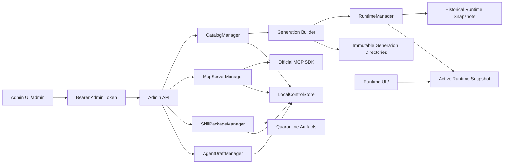

# SAGE 控制面实现设计

> **版本：** 0.1  
> **状态：** 本地单机实现  
> **适用部署：** Windows VM + 单 FastAPI 进程  
> **持久化：** 原子 JSON 元数据 + 本地不可变制品目录

## 1. 范围

当前控制面实现覆盖：

- Agent 草稿创建、编辑、验证、克隆版本和发布。
- 单 Skill ZIP 上传、隔离解包、验证、原包与规范化包下载。
- MCP Server 配置、连接测试、Tool discovery 和导入为 Skill 草稿。
- Catalog Candidate 创建、验证、审批、原子激活和审批后回滚。
- active Generation 运行时热切换。
- workspace、principal、thread 到 Generation 的持久绑定。

本阶段不实现通用 PostgreSQL 控制存储、长期 Memory、多实例写一致性和每调用强沙箱。生产 Python Skill 已通过独立 Runner 形成服务级隔离，但不视为敌对多租户代码的强沙箱。

## 2. 组件



关键实现：

| 组件 | 文件 | 责任 |
|---|---|---|
| 控制面记录 | `src/sage/control_models.py` | 草稿、验证、MCP、Candidate、审批和 Generation 数据结构 |
| 本地 Store | `src/sage/control_store.py` | schema migration、进程锁、flush/fsync、原子 replace |
| Agent 草稿 | `src/sage/agent_drafts.py` | 创建、编辑、克隆、能力验证和不可变版本检查 |
| Skill 包 | `src/sage/skill_packages.py` | ZIP 隔离、结构验证、摘要和双制品下载 |
| MCP 管理 | `src/sage/mcp_control.py` | transport、allowlist、secret、测试、发现和调用 |
| Catalog | `src/sage/catalog.py` | Candidate、diff digest、审批、构建、激活和回滚 |
| Runtime | `src/sage/runtime_manager.py` | Runtime Snapshot、active pointer 和 thread pinning |
| Admin API | `src/sage/admin_api.py` | Bearer Token 保护的控制面 REST API |
| Admin UI | `src/sage/static/admin.html` | 五个控制台视图及完整操作流 |

## 3. 本地数据布局

默认数据根目录为 `.sage-state/`，可用 `SAGE_CONTROL_DATA_ROOT` 修改。

```text
.sage-state/
├── control-plane.json
├── artifacts/
│   └── skills/<package-id>/<skill-name>/
├── uploads/
│   └── <package-id>/
│       ├── original.zip
│       └── normalized.zip
└── generations/
    ├── gen_startup/skills/
    └── <generation-id>/skills/
```

`control-plane.json` 带 `schema_version`。写入过程为：

1. 在同目录写入临时文件。
2. flush 并执行 `fsync`。
3. 使用 `os.replace` 原子替换当前状态文件。

schema 升级会使未完成审批失效并要求重新验证。该实现适合单进程 VM，不提供多进程事务隔离；迁移 PostgreSQL 时应保持现有 Store 行为契约。

## 4. Agent 生命周期

```text
Create draft
  -> Edit draft
  -> Validate definition and capability bindings
  -> Add to Catalog Candidate
  -> Validate Candidate
  -> Submit approval
  -> Approve
  -> Activate Generation
  -> Published and immutable
  -> Clone with a new version for later changes
```

验证内容：

- `agent_id` 使用小写字母、数字和连字符。
- version 使用语义版本语法。
- instructions 非空。
- capability IDs 在 Candidate 的可执行能力集合中存在。
- subagent 只能绑定父 Agent 已拥有的能力。
- exclusive capability 必须同时属于对应 subagent。
- 同一个 `agent_id + version` 发布后不可改变内容。

`name` 是页面显示名，`agent_id` 是发布、API 和默认 Agent 选择使用的稳定标识，两者可以不同。例如显示名 `testagent` 的实际 ID 可以是 `willteste`。Catalog 页面通过下拉框选择 Default Agent，不能填写 Candidate 标题或显示名代替 `agent_id`；留空表示继续使用当前 Generation 的默认 Agent。

内置诊断 Agent 会作为 `published` 记录进入管理台，可查看并克隆，不能原地修改。

## 5. Skill ZIP 生命周期

一个 ZIP 只能包含一个 Skill。允许两种布局：

```text
SKILL.md
skill.yaml
scripts/...
```

或：

```text
skill-name/
├── SKILL.md
├── skill.yaml
└── scripts/...
```

安全门禁：

- 上传上限 50 MiB。
- 最多 200 个文件。
- 单文件实际解压上限 20 MiB。
- 实际总解压上限 100 MiB。
- 拒绝绝对路径、`..`、盘符、符号链接、加密 ZIP 和重复路径。
- 拒绝 Windows 设备名。
- 拒绝 EXE、DLL、PowerShell、wheel 等可执行或二进制载荷。
- 拒绝 `requirements.txt`、`pyproject.toml`、lockfile 等依赖安装入口。
- 强制 `SKILL.md`、`skill.yaml`、目录名和 manifest name 一致。
- 验证和激活时重新计算目录摘要。

上传的 Python subprocess Skill 可以进入 Catalog，其可见性和执行继续受 manifest policy、Capability View 与部署模式约束。Development 在未配置 Runner 时可使用管理员可信的本地 subprocess；Production 禁止宿主 fallback，未配置 Runner 时 Python Skill 不会出现在用户 Capability View，Executor 也会再次拒绝调用。

配置 Runner 后，API 传输内容寻址的 Skill 包与已授权 Artifact，Runner 重验身份、摘要、Schema、timeout 和输出上限。`GET /health/ready` 同时协商 Runner 协议与 profile；依赖不可达或不兼容时返回 `503`。

下载支持：

- `original`：管理员原始上传包。
- `normalized`：平台规范化后的单根目录包。

## 6. MCP 生命周期

```text
Create configuration
  -> Test connection
  -> Discover tools
  -> Capture schema digest
  -> Select tool
  -> Add description, instructions and risk
  -> Generate Skill draft
  -> Candidate / approval / activate
  -> Runtime invocation with digest checks
```

### 6.1 Transport

- Streamable HTTP 使用官方 Python MCP SDK。
- URL 必须为无内嵌凭据的 HTTPS URL。
- hostname 或 `hostname:port` 必须存在于 `SAGE_MCP_ALLOWED_HOSTS`。
- 每次连接重新执行 DNS 解析。
- HTTP redirect 不自动跟随。
- stdio 只能引用 `SAGE_MCP_STDIO_PRESETS` 中的 operator-approved preset。
- 请求不能提供任意命令、参数、cwd 或环境变量。
- stdio 子进程仅继承受限系统环境和 preset 显式环境。

本地开发可显式设置：

```dotenv
SAGE_MCP_ALLOWED_HOSTS=127.0.0.1:8765
SAGE_ALLOW_INSECURE_LOCAL_MCP=true
```

此时仅当 URL 在 allowlist 中，且 DNS 的所有解析结果都是 loopback 地址时，才允许明文 HTTP。该开关不能放宽到局域网、公网或生产环境。

### 6.2 Secrets

默认仅接受环境变量名称作为 `secret_ref`。运行时读取对应环境变量，API 永不返回值。

只有显式设置：

```dotenv
SAGE_ALLOW_PLAINTEXT_DEV_SECRETS=true
```

才允许把开发密钥写入本地 JSON。即使启用，列表和详情 API 仍不会回显密钥。该模式不能用于共享或生产 VM。

### 6.3 Freshness 和版本固定

- Test 和 discovery 默认 15 分钟有效。
- 配置摘要发生变化后，旧 test/discovery 立即失效。
- 导入的 Skill 同时固定 `serverConfigDigest` 和 `schemaDigest`。
- Runtime 调用前再次比较两个摘要。
- 任一摘要不一致时拒绝调用，不自动接受上游变化。
- discovery 超过 freshness window 后，即使 Skill 已发布也会暂停调用，直到管理员重新 Test 和 Discover。
- Agent 调用还要求对应 `AgentDefinition.capability_ids` 显式包含导入后的 `skill:<name>`；只在 instructions 中提及 MCP 不会授予 Tool 权限。

## 7. Candidate、审批与激活

Candidate 总是基于创建时的 active Generation，并同时包含所选 Agent 和 Skill 变化。

验证过程：

1. 确认 base Generation 存在且目录摘要未变化。
2. 重新计算每个 Skill quarantine artifact 的摘要。
3. 重新计算每个 Agent draft 的摘要。
4. 检查 immutable `name/id + version` 没有发生内容覆盖。
5. 检查 Agent 绑定的能力在目标 Catalog 中存在且可执行。
6. 检查 MCP test/discovery 未过期，server 与 tool digest 未漂移。
7. 拒绝没有实际变化的 Candidate。
8. 生成包含 builder policy 版本的 `diff_digest`。

审批绑定 `diff_digest`。审批后激活仍完整重跑验证；任何字节、配置、active base 或 builder policy 变化都会阻止激活。

激活过程：

1. 将 base Generation 复制到新的 staging 目录。
2. 覆盖 Candidate 中的新 Skill 版本。
3. 对不可信可执行代码写入禁用策略。
4. 加载完整 Registry 并构建 Agent Catalog。
5. 计算最终 Generation digest。
6. staging 原子重命名为不可变 Generation 目录。
7. 构建 Runtime Snapshot。
8. 使用 active Generation compare-and-swap 语义切换指针。
9. 将审批标为 consumed，资源标为 published。

失败时 active pointer 保持不变。

## 8. Thread 一致性与回滚

thread binding key 包含：

```text
workspace_id : principal_id : thread_id
```

新 thread 捕获当前 active Generation，后续消息继续使用原 Generation。激活或回滚不会静默迁移已有 thread；用户创建新 thread 后才使用新的 active Generation。

回滚流程：

```text
Select historical Generation
  -> Request rollback approval
  -> Explicit approval with reason
  -> Recheck active-from and target digest
  -> Switch active pointer
```

历史 Artifact 不被修改。回滚后，已经绑定到后来 Generation 的 thread 仍保持原绑定。

## 9. Admin API

开发与自动测试环境中，`SAGE_ADMIN_AUTH_ENABLED` 默认是 `false`，`GET /v1/control/bootstrap` 会返回 `admin_auth_enabled: false`，Admin UI 直接连接。Production 强制该值为 `true`；关闭时配置校验失败，服务不会启动。

启用门禁时显式配置：

```dotenv
SAGE_ADMIN_AUTH_ENABLED=true
```

启用后，anonymous 模式使用 `Authorization: Bearer <SAGE_ADMIN_TOKEN>`。Development 未显式配置 Token 时使用 `sage-local-admin`；production 不合成 Token，缺失时返回 `503`，错误 Token 返回 `401`。

Entra 模式启用 Admin 鉴权后不使用共享 Token，而要求已验证的 Access Token 包含 `platform_admin` 或 `capability_admin` app role。

| Area | Endpoints |
|---|---|
| Status | `GET /v1/admin/status`, `GET /v1/admin/capabilities` |
| Agents | `GET/POST /v1/admin/agents`, `PUT /v1/admin/agents/{id}`, `POST .../validate`, `POST .../clone` |
| Skills | `GET /v1/admin/skills`, `POST /v1/admin/skills/uploads`, `POST .../validate`, `GET .../download/{kind}` |
| MCP | `GET/POST /v1/admin/mcp/servers`, `PUT .../{id}`, `POST .../test`, `POST .../discover`, `POST .../tools/{tool}/import` |
| Candidates | `GET/POST /v1/admin/candidates`, `POST .../validate`, `POST .../submit`, `POST .../activate` |
| Approvals | `GET /v1/admin/approvals`, `POST .../approve`, `POST .../reject`, `POST .../rollback` |
| Generations | `GET /v1/admin/generations`, `GET .../{id}/diff`, `POST .../{id}/rollback-request` |

## 10. 配置

```dotenv
SAGE_ENVIRONMENT=production
SAGE_ADMIN_AUTH_ENABLED=true
SAGE_ADMIN_TOKEN=<high-entropy-random-token>
SAGE_EVALUATION_GATE_MODE=advisory
SAGE_CONTROL_DATA_ROOT=.sage-state
SAGE_MCP_ALLOWED_HOSTS=learn.example.com,internal.example.com:8443
SAGE_MCP_HEALTH_TTL_SECONDS=900
SAGE_MCP_STDIO_PRESETS={"local-docs":{"command":"C:\\tools\\docs-mcp.exe","args":[],"secret_env_name":"MCP_TOKEN"}}
SAGE_ALLOW_PLAINTEXT_DEV_SECRETS=false
SAGE_ALLOW_INSECURE_LOCAL_MCP=false
```

管理页面：`/admin`。鉴权关闭只允许用于 development；启用后，Token 或 Entra Access Token 只保存在当前浏览器 tab 的 `sessionStorage`。

`SAGE_EVALUATION_GATE_MODE=advisory` 将缺失或未通过的锁定评测报告记录为 warning，不阻止 Candidate 激活；`required` 将其提升为 error。该设置控制发布策略，不改变历史 Evaluation Report、Solution Release 或 Generation。

项目内置的 `scripts/demo_mcp_server.py` 可用于验证 initialize、list_tools 和 call_tool 三段真实协议流程。默认端点是 `http://127.0.0.1:8765/mcp`，提供 `calculate_total` 与 `lookup_runbook`。

## 11. 已知限制

- Admin 鉴权关闭时，任何能访问服务端口的人都能调用管理 API，只能用于受控开发/测试网络。
- 共享 Admin Token 仅是可重新启用的兼容门禁；需要职责分离时应启用 Entra app roles。
- JSON Store 只支持单进程；不能让多个 Web/Worker 实例同时写。
- Checkpoint、Run 和附件仍为内存/临时目录，不跨服务重启。
- Python Runner 提供服务级进程/容器隔离，但尚未提供 per-invocation Pod/Job、gVisor/Kata 或 microVM 强沙箱。
- MCP stdio 使用 operator preset，但尚未放入独立容器或 Job Object。
- MCP HTTP allowlist 和 DNS 重查降低 SSRF 风险，但没有实现 IP pinning 或独立网络代理。
- 没有恶意软件扫描、签名、SBOM 和依赖构建。
- 审批为单 token 单人审批，不提供真实职责分离。
- 本地 Generation Artifact 未做签名，也没有自动保留期清理。

这些限制必须在迁移通用 PostgreSQL Provider、独立 MCP Gateway 和每调用 Sandbox 时继续收敛，不能通过 UI 文案掩盖。
