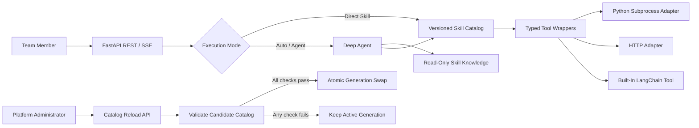

# SAGE: Turning Team Skills into Governed Agent APIs

> **Working project name:** SAGE (Skill Agent Governance Engine)  
> **One-line positioning:** Give Agent Skills GitOps-style validation, immutable releases, generation-consistent Direct/Agent execution, and failed-release rollback. Deterministic tasks bypass the LLM, while complex tasks are progressively discovered and orchestrated by a Deep Agent.  
> **Current status:** Runnable prototype with an execution workspace and local governance control plane.  
> **Document purpose:** Team alignment, Hackathon application, technical decision-making, demo design, and pitch preparation.

---

## 1. Executive Summary

This idea is a strong fit for a Hackathon and has the potential to rank highly. However, the winning story cannot simply be "LangChain calls several Skills." Agent tool-calling demos are already common, and judges are unlikely to remember another framework integration on its own.

The stronger SAGE proposition is:

> **How can an individual or small team's AI Skill move from a local prompt or script into a capability that the whole organization can safely reuse, continuously update, and reliably operate?**

The project should prove three core values:

1. **Deterministic direct execution:** When the target Skill is known, invoke it without an LLM to reduce latency, cost, and uncertainty.
2. **Progressive orchestration:** For complex natural-language requests, a Deep Agent discovers the relevant Skills, loads only the instructions it needs, and composes the execution.
3. **Safe upgrades and recovery:** Administrators can publish Skills at runtime. Valid generations become active atomically, invalid generations are rejected, and in-flight requests remain unaffected.

A championship-level demo should not maximize feature count. It should let judges see one complete chain of evidence in three minutes:

```text
A team member creates a Skill
  -> the platform validates and publishes it
  -> another team member invokes it through one API
  -> an Agent composes multiple Skills
  -> a Skill is upgraded without interrupting active work
  -> an invalid upgrade is rejected and the previous version remains available
```

---

## 2. The Problem We Are Solving

### 2.1 AI Capability Silos Inside Teams

Teams are already using AI to improve productivity, but useful capabilities are fragmented across many forms:

- Prompts and `SKILL.md` files on individual machines
- Python, PowerShell, or command-line scripts
- LangChain Tools and internal Agents
- Department-specific HTTP APIs
- Operational procedures and expert knowledge stored in documents
- Diagnostic utilities that only run in specialized environments

These capabilities repeatedly encounter the same problems:

| Problem | Direct impact |
|---|---|
| High adoption cost | Other team members must install environments, understand parameters, or read code |
| No unified entry point | Every Skill has a different invocation method |
| No automatic discovery | Users must know which Skill exists and when to use it |
| Difficult updates | Prompt or code changes require restarts, redeployment, or manual communication |
| Weak governance | Timeouts, permissions, input/output contracts, and network access often exist only in documentation |
| Limited observability | Teams cannot easily answer what ran, how long it took, or where it failed |
| Unbounded Agent behavior | Every request is routed through an LLM, increasing cost and variability |

### 2.2 Three Core Personas

**Capability owner**

- Has already built a Skill, prompt, script, or internal API.
- Wants others to use it without building and operating a separate service for every capability.

**Platform administrator**

- Needs to validate the Skill entry point, schema, permissions, timeout, and side effects.
- Needs failed releases to leave existing users unaffected.

**Team member**

- Wants to describe a need and receive a result.
- Should not need to understand Skill installation, runtime dependencies, or model configuration.

### 2.3 Core User Story

> As a team member, I want to submit a natural-language request through one API and have the system select and compose approved team Skills. When I know the exact target, I also want to invoke that Skill directly for a lower-cost and more deterministic result.

### 2.4 Enterprise AI Pain-Point Coverage

From an enterprise AI and Agent engineering perspective, this concept addresses a real but often overlooked problem:

> Enterprises usually do not lack AI demos. They lack a reliable way to turn fragmented AI capabilities into reusable, governed, and sustainable organizational assets.

SAGE does not attempt to solve every enterprise AI challenge during a Hackathon. It focuses on the minimum closed loop from "personal Skill" to "team service," with explicit extension points for enterprise production requirements.

#### Coverage Matrix

| Enterprise AI pain point | SAGE mechanism | Verifiable evidence | Current coverage |
|---|---|---|---|
| Prompts, scripts, and internal APIs become capability silos | Unified Skill packages, Catalog, and Web API | Different Skill types use one request contract | **Directly addressed** |
| Every capability requires a separately built service | Adapters unify Python, Tool, and HTTP execution | Adding a Skill does not change the client API | **Directly addressed** |
| Users must understand the implementation and runtime | Natural-language Auto mode plus typed Direct mode | Users do not install the original Skill environment | **Directly addressed** |
| Every request goes through an LLM | Deterministic tasks use Direct Skill execution | Runtime metadata shows `model_calls: 0` | **Directly addressed** |
| Context grows as the Skill library expands | Deep Agent progressively loads metadata, instructions, and resources | Only selected `SKILL.md` files are read | **Directly addressed** |
| Tool boundaries exist only in prompts | `skill.yaml` enforces schema, timeout, network, and side-effect policies | Invalid inputs, entries, and endpoints are rejected by the server | **Validated in MVP** |
| Skill updates require restarts and can affect active requests | Catalog generations, atomic swaps, and session generation pinning | Old requests continue while new requests use the new generation | **Directly addressed** |
| Failed releases are difficult to recover from | Complete candidate validation and failed-refresh rollback | Invalid releases leave the active generation unchanged | **Directly addressed** |
| Agent execution is opaque | REST results, SSE lifecycle events, and structured run metadata | Skill, Tool, duration, budget, and status are visible | **Partially addressed** |
| User, role, and tenant authorization is missing | Authentication and Tool filtering are extension points | MVP uses a shared key and has no user identity | **Not yet addressed** |
| Privacy, data residency, and industry compliance | Redaction Skills, minimal logging, and network allowlists | No complete data classification or compliance policy engine yet | **Partially addressed** |
| Dynamic code can compromise the host | Trusted directory, subprocess execution, and resource limits | A subprocess is not a security sandbox | **Partially addressed** |
| Multi-instance availability and durable jobs are required | Local control metadata and immutable Generation artifacts survive restarts; runtime state has replaceable Store ports | Checkpoints, Runs, and attachments remain process-local | **Partially addressed** |

#### High-Value Problems Directly Addressed

**1. Turning personal expertise into an organizational asset**

Capability owners maintain the Skill knowledge, schema, and execution entry point. Other team members consume the capability through one API without depending on the original author for manual support. This addresses the common enterprise problem of "we can build it, but we cannot distribute it."

**2. Avoiding excessive Agent use**

Not every enterprise task requires model reasoning. SAGE separates deterministic execution from model orchestration: known targets are invoked directly, while uncertain multi-step goals use an Agent. This reduces cost, latency, and hallucination risk.

**3. Controlling context and Tool scale**

Loading every Skill description into a system prompt is not scalable. Progressive disclosure lets the model see concise metadata first and read full instructions or resources only after a Skill becomes relevant.

**4. Turning governance language into enforceable policy**

A prompt can advise an Agent what it should do, but it cannot be a dependable security boundary. `skill.yaml` turns input/output contracts, timeouts, idempotency, network targets, and side effects into server-enforced policies.

**5. Reducing change risk for AI capabilities**

Enterprise capabilities continuously evolve, so release behavior matters as much as invocation behavior. Immutable generations, request pinning, and failed-release rollback show that SAGE addresses both execution and safe evolution.

#### Areas That Require Production Hardening

The Hackathon MVP can validate the governance direction, but enterprise deployment would still require:

- Entra ID, OIDC, or JWT-based user identity
- Skill visibility and execution permissions by user, role, department, and tenant
- Data classification, sensitive-data handling, residency, retention, and deletion policies
- Containers or remote sandboxes instead of host subprocesses
- Skill package signing, approval, malware scanning, and software supply-chain controls
- Persistent databases, Redis, or durable LangGraph checkpointers for sessions and audit history
- Job queues, idempotency keys, retry policy, multi-instance coordination, and disaster recovery
- Human-in-the-loop approval for high-risk, mutating, or expensive operations
- Offline Skill evaluation, regression suites, release quality gates, and version retirement
- Model and Tool budgets, quotas, alerts, and departmental cost allocation

#### Enterprise Positioning Boundary

We should not claim:

> SAGE has solved all enterprise AI governance problems.

A more accurate and credible statement is:

> **SAGE validates the minimum closed loop for developing, discovering, executing, and safely upgrading trusted enterprise AI capabilities. It is a governance-layer prototype connecting personal Skills with an enterprise AI platform.**

Enterprises do not adopt a product because it uses a particular Agent framework. They ultimately ask:

- How long does it take to onboard a capability?
- How many team members can safely reuse it?
- How many unnecessary model calls can be avoided?
- Are failures and failed releases controlled?
- Can we trace who invoked which capability, with what outcome and cost?

The Hackathon validation should therefore focus on measurable organizational value, not framework feature count.

---

## 3. Solution Overview

### 3.1 The Skill Package

Each Skill uses two complementary files:

```text
skills/
└── pii-redact/
    ├── SKILL.md
    ├── skill.yaml
    ├── scripts/
    ├── references/
    └── assets/
```

**`SKILL.md`: tells the Agent why and how to use the capability**

- Skill name and natural-language description
- Applicable scenarios and activation keywords
- Procedures, boundaries, and examples
- Reference material to load only when needed

**`skill.yaml`: tells the server how the capability is allowed to execute**

- Version and execution type
- Entry point or server-managed endpoint alias
- Input and output JSON Schema
- Timeout, idempotency, and side-effect classification
- File, network, and environment-variable policy

This separation is an important part of the project:

> Prompts guide intelligence. Manifests constrain execution. Security boundaries do not depend on model compliance.

### 3.2 Two Execution Paths

#### Direct Skill

The client explicitly selects a Skill:

```text
Request -> Registry -> Schema validation -> Adapter -> Result
```

Characteristics:

- No model invocation
- Lower latency and cost
- Validated parameters and results
- Suitable for automation and system integration

#### Deep Agent

The client describes an outcome rather than selecting a Tool:

```text
Request -> Deep Agent -> Progressive SKILL.md loading -> Tool selection/composition -> Result
```

Characteristics:

- Suitable when the goal is known but the steps are uncertain
- Can compose multiple Skills
- Loads full Skill instructions and references only when needed
- Autonomy is bounded through budgets, timeouts, and Tool allowlists

### 3.3 High-Level Architecture



### 3.4 Hot-Reload Semantics

"Hot reload" does not mean immediately executing any file that appears in a directory. It is an administrator-triggered, controlled release process:

1. Scan a trusted directory.
2. Validate `SKILL.md`, `skill.yaml`, schemas, entry points, and security policy.
3. Build a complete candidate Catalog.
4. Run lightweight self-checks.
5. Atomically activate the new generation only if every check succeeds.
6. Preserve the current generation if any check fails.

Each request captures a generation when it starts:

- In-flight requests continue using the previous version.
- New requests use the new version.
- Existing sessions keep a consistent version to prevent behavior changes during a conversation.

---

## 4. Technical Feasibility

### 4.1 Proposed Technologies

| Capability | Proposed technology | Feasibility assessment |
|---|---|---|
| Web API | FastAPI + Pydantic | Mature, fast to develop, and produces OpenAPI automatically |
| Agent orchestration | LangChain Deep Agents | Supports progressive Skill loading, Tool calling, subagents, and context management |
| State and runtime | LangGraph | Supports checkpointers, threaded state, budgets, and streamed events |
| Skill format | Agent Skills `SKILL.md` | Existing directory and frontmatter specification |
| Execution manifest | Custom `skill.yaml` | Strictly validated with Pydantic at manageable implementation cost |
| HTTP Skill | HTTPX AsyncClient | Connection pooling, timeouts, streaming, and MockTransport support |
| Dynamic Python | `asyncio` subprocess + JSON stdin/stdout | Sufficient for lifecycle isolation, but not a security sandbox |
| Streaming output | FastAPI SSE | Well suited to Agent, Tool, and progress events |
| Offline testing | pytest + fake chat model + MockTransport | Avoids live network and model dependencies during the demo |

### 4.2 Why It Is Achievable in a Hackathon

The project does not build an Agent runtime from scratch. It combines mature components and concentrates implementation effort on the differentiating layer:

- Skill package loading and validation
- A unified Adapter contract
- Direct and Agent execution paths
- Catalog generations and atomic refresh
- Safe event streaming and failure recovery

### 4.3 Time-Boxed Scope

#### 24-Hour Core

- One hero scenario
- `SKILL.md + skill.yaml` loading
- Direct and Auto modes
- Python and built-in Tool execution
- Basic SSE
- Successful Catalog refresh and failed-refresh rollback

#### 48-Hour Recommended Build

- Four Skill forms: Prompt, Python, LangChain Tool, and HTTP
- Deep Agent progressive loading
- Generation visualization
- Timeout, Tool budget, and cancellation
- Offline evaluation data
- Complete three-minute demo and backup recording

#### 72-Hour Stretch Build

- Small run console
- Scenario gallery
- Richer observability
- MCP Adapter proof of concept
- One high-risk Skill requiring human approval

### 4.4 Honest Limitations

- A subprocess provides lifecycle isolation, not a malicious-code security sandbox.
- The MVP accepts Skills only from an administrator-trusted directory.
- An in-memory checkpointer does not support production multi-instance deployment or restart recovery.
- SSE events are not persisted and cannot be replayed after reconnection.
- A Deep Agent can still select the wrong Skill, so critical business outcomes cannot rely on model judgment alone.

These limitations strengthen the proposal by demonstrating that the team understands real Agent system boundaries.

---

## 5. Effectiveness and Value Validation

### 5.1 Value to the Team

**Reuse expert capability**

Turn knowledge that only the author can use into an API available to the whole team.

**Reduce adoption cost**

Consumers do not install the original environment or understand implementation details.

**Avoid unnecessary model calls**

Execute deterministic tasks directly and invoke a model only when reasoning or composition is required.

**Shorten capability release cycles**

Update Skills independently instead of building and redeploying a complete service for each capability.

**Improve Agent governance**

Input/output contracts, timeouts, network policy, versions, and side effects become enforceable server policies.

### 5.2 Metrics We Must Not Invent

The pitch should not claim "80% faster" or "90% cheaper" unless those results come from a reproducible experiment. Define the metrics first, then report actual measurements.

| Metric | Measurement method | Demo target |
|---|---|---|
| Direct model calls | Runtime metadata | Must equal 0 |
| Skill selection accuracy | Compare expected and actual calls on a fixed task set | Report measured results |
| Progressive loading ratio | Count loaded `SKILL.md` files | Load only task-relevant Skills |
| End-to-end latency | Record P50/P95 | Compare Direct and Agent modes without inventing a target |
| Token usage | Model usage metadata | Compare eager and progressive loading |
| Refresh atomicity | Attempt to publish an invalid version | Active generation must remain unchanged |
| Request version consistency | Record start and end generations | A request must never drift |
| SSE integrity | Validate event sequences automatically | Exactly one terminal event per run |
| Security rejection rate | Test path traversal, invalid URLs, and similar inputs | Reject every malicious test case |

### 5.3 Recommended Offline Experiment

Prepare 20 to 30 fixed tasks:

- 10 deterministic Direct Skill tasks
- 10 single-Skill Agent tasks
- 10 multi-Skill orchestration tasks

Compare three approaches:

1. Route every task through a conventional Agent.
2. Use SAGE Auto mode.
3. Use SAGE Direct Skill mode.

Measure:

- Latency
- Number of model calls
- Token usage
- Skill/Tool selection results
- Completion rate and error categories

Any reported result must include the model, hardware, sample size, and test conditions.

---

## 6. Why This Can Be a Winning Hackathon Project

### 6.1 Innovation

A typical Agent demo asks:

> How can a model call a Tool?

SAGE asks:

> How can a team publish a validated set of Agent Skills as an immutable release while ensuring that Direct and Agent requests use a consistent version and can immediately fall back after failure?

The differentiating combination is:

- Standard `SKILL.md` bound to enforceable execution policy
- A release gate combining structural validation, behavioral evaluation, and security checks
- Direct and Agent execution paths
- Immutable Catalog generations
- Request and session generation pinning
- Complete candidate validation, atomic activation, and failed-release rollback

Mature projects already provide the Skill specification, Agent harnesses, MCP gateways, and evaluation tooling. SAGE should not claim those components as new. Its innovation is connecting them into a delivery loop that can validate, publish, pin, and roll back enterprise Agent Skills.

### 6.2 Business and Organizational Value

- Turn internal AI capabilities from personal assets into organizational assets.
- Reduce repeated development of one-off Skill Web services.
- Establish a foundation for permissions, audit, cost allocation, and a future Skill marketplace.
- Allow teams using different languages and runtimes to develop capabilities independently.

### 6.3 Technical Depth

Judges can see the following behavior live instead of only hearing about it in an architecture diagram:

- Typed inputs and outputs
- Asynchronous streaming execution
- Immutable snapshots under concurrent use
- Thread-to-generation pinning
- Timeout, budget, and cancellation handling
- Transactional rejection of invalid versions
- Separation between model reasoning and execution authority

### 6.4 Demo Impact

The project naturally provides four visible moments:

1. `model_calls: 0`: a simple task does not need an LLM.
2. SSE timeline: the Agent progressively loads and invokes multiple Skills.
3. Generation swap: old and new requests safely run different versions.
4. Invalid-release rollback: the refresh fails while the service remains operational.

### 6.5 Judging-Criteria Mapping

| Judging dimension | SAGE evidence | What to emphasize |
|---|---|---|
| Innovation | Evaluation gates, immutable generations, and request version pinning | Transactional delivery for Agent Skills, not another Tool gateway |
| Business value | Expert capability exposed through one API | Build once, reuse across the team |
| Technical depth | Snapshots, rollback, budgets, and cancellation | Real Agent adoption needs governance |
| Completeness | Fully offline, runnable closed loop | No slide-only features or fragile live dependencies |
| User experience | Natural language, Direct API, and SSE | Serves both people and automation systems |
| Extensibility | Adapters and an MCP evolution path | New execution types do not change the client API |

---

## 7. Ecosystem Research, Competition, and Corrected Positioning

### 7.1 Research Conclusion

As of August 17, 2026, GitHub and related official sites already contain mature Agent Skills specifications, Skill marketplaces, Agent harnesses, MCP registries and gateways, Tool platforms, evaluation tools, and Skill-evolution projects.

This research did not identify a mainstream project explicitly providing the entire following combination:

```text
Native Agent Skills support
+ Direct / Agent execution paths
+ Structural and behavioral release gates
+ Immutable Catalog generations
+ Request/session version pinning
+ Atomic candidate activation and failed-release rollback
```

This is not proof that no such implementation exists anywhere. It does indicate a testable differentiation opportunity. At the same time, unified registries, gateways, Tool routing, Skill sharing, and Agent SSE are no longer open territory and must not be presented as the primary innovation.

### 7.2 Verified Related Projects

| Project | Existing capabilities | Relationship to SAGE |
|---|---|---|
| [Agent Skills](https://github.com/agentskills/agentskills) | Open `SKILL.md` specification, progressive disclosure, and reference validator | Adopt the standard and `skills-ref`; do not invent a replacement base format |
| [Anthropic Skills](https://github.com/anthropics/skills) | Official examples and portable Skill packages | Reference for Skill authoring and package structure |
| [LangChain Deep Agents](https://github.com/langchain-ai/deepagents) | Skills, Tools, subagents, memory, sandboxes, and streamed events | Use as the Agent execution engine rather than rebuilding a harness |
| [LangSmith Fleet Skills](https://docs.langchain.com/langsmith/fleet/skills) | Private/shared Skills, workspace synchronization, AI creation, and local pull | Team Skill sharing already exists; SAGE must emphasize transactional release and execution consistency |
| [ToolHive](https://github.com/stacklok/toolhive) / [Registry Server](https://github.com/stacklok/toolhive-registry-server) | MCP runtime and gateway, container isolation, Skill/Plugin version discovery, OIDC, audit, and multi-source sync | A strong enterprise-governance competitor and possible future MCP execution substrate |
| [Microsoft MCP Gateway](https://github.com/microsoft/mcp-gateway) | Tool/MCP Server deployment, dynamic routing, Entra ID, Agents/Sessions, SSE, and management UI | The closest runtime comparator; unified Tool and Agent APIs cannot be claimed as unique |
| [IBM ContextForge](https://github.com/IBM/mcp-context-forge) | MCP/A2A/REST/gRPC gateway, registry, RBAC, plugins, guardrails, and OTel | Reusable enterprise connectivity and governance, without an Agent Skills transactional-release focus |
| [Dify](https://github.com/langgenius/dify) | Agents, workflows, RAG, Tools, APIs, and LLMOps | A broad SAGE scope would look like a small Dify; stay narrow and deep |
| [Composio](https://github.com/ComposioHQ/composio) | Large Tool catalog, dynamic discovery, user auth, sandbox, MCP, and framework adapters | Can provide remote Tools and authorization; SAGE should not build another SaaS integration catalog |
| [AAS Core](https://github.com/sickn33/agentic-awesome-skills) | Skill catalog, Agent-owned selection, Stack Manifest, validation, and immutable plan preview | Similar Catalog/planning concept, while transactional Apply and Recovery remain explicitly experimental |
| [skills.sh](https://skills.sh/) | Skill search, installation, leaderboard, packs, and security audits | Solves public discovery and distribution, not enterprise request execution or version pinning |
| [agent-skills-eval](https://github.com/darkrishabh/agent-skills-eval) | With/without-Skill evaluation, judges, Tool assertions, CI, and HTML reports | A good SAGE release gate; do not rebuild the complete evaluation framework |
| [Tencent SkillHone](https://github.com/Tencent/SkillHone) | Whole-folder Skill evolution, regression evaluation, and Git Issue/PR/Wiki audit | A future Skill improvement loop complementary to runtime publishing |
| [MDA](https://github.com/sno-ai/mda) | Versions, dependencies, digests, signatures, trust policy, and multi-format compilation | Useful for supply-chain trust; keep SAGE execution metadata minimal and avoid duplication |

### 7.3 Closest Competitive Surfaces

**ToolHive: enterprise Skill and MCP governance**

ToolHive Registry Server already supports version discovery for MCP Servers, Skills, and Plugins, along with OIDC/JWT visibility, role management, audit, multi-source synchronization, and PostgreSQL. The broader platform adds a container runtime, gateway, and portal. SAGE should not recreate an enterprise MCP platform during a Hackathon.

**Microsoft MCP Gateway: unified Tool and Agent runtime**

This project already provides REST control planes for Tools and MCP Servers, container deployment, dynamic Tool routing, Entra ID authorization, Agents/Sessions, and SSE. It significantly overlaps the original "one API for Agents and Tools" narrative.

**LangSmith Fleet: team Skill sharing**

Fleet provides private and workspace-shared Skills that remain synchronized across Agents. Team sharing is valuable, but it is not unique differentiation.

**AAS Core: Catalog selection and immutable plans**

AAS Core converts Agent selection into a validated Stack Manifest and immutable plan. Transactional Apply and Recovery are still experimental, which reinforces that SAGE should prove runtime consistency and reliable activation rather than only generate a plan.

### 7.4 Differentiation SAGE Should Retain

After correcting for existing projects, SAGE is not "another registry or gateway." Its focused position is:

> **A transactional delivery and runtime control plane for Agent Skills.**

It should prove the following closed loop:

1. Treat a set of Skills as one release unit rather than activating files independently.
2. Run format validation, execution-contract validation, security checks, and behavioral evaluation before publication.
3. Build a content-addressed, immutable generation.
4. Make Direct and Agent requests capture the same generation.
5. Keep requests and sessions pinned throughout execution.
6. Atomically activate a candidate only after every gate passes.
7. Continue serving the previous generation after activation failure or evaluation regression.
8. Expose one evidence model for model calls, Skill selection, version, duration, and terminal status.

This position can be summarized as:

> **GitOps-style deployment and runtime governance for Agent Skills.**

### 7.5 Reuse First, Do Not Rebuild the Ecosystem

| Layer | Prefer to reuse | Minimum SAGE-owned behavior |
|---|---|---|
| Skill format | Agent Skills + `skills-ref` | Minimal enterprise execution binding |
| Agent orchestration | Deep Agents | Generation injection, budgets, and normalized results |
| MCP execution | ToolHive, Microsoft MCP Gateway, or ContextForge | Adapter and version reference |
| Behavioral evaluation | agent-skills-eval | Release-gate policy and verdict handling |
| Content trust | MDA/Sigstore concepts | Digest and trust-policy integration |
| Continuous improvement | SkillHone | Accept approved candidate revisions |
| Transactional publication | No complete equivalent identified | Candidate, Generation, Pin, Activate, and Rollback |

The Hackathon MVP can use local simplified components to prove the final row and replace the lower layers later. This lets SAGE coordinate the ecosystem instead of competing with mature platforms on feature count.

### 7.6 Corrected Pitch Language

Avoid saying:

> SAGE sits above MCP, workflows, and API gateways to govern every capability.

Use instead:

> **SAGE reuses the Agent Skills, Deep Agent, MCP Gateway, and evaluation ecosystems, then adds the transactional delivery loop from candidate Skill to stable production generation.**

---

## 8. Hero Scenario: Intelligent Customer Feedback Processing

> **Status: Recommended live demo.**  
> **Why this scenario:** It is industry-neutral, easy to run with synthetic data, low risk, and naturally demonstrates four Skill forms.

### 8.1 Story

A product manager receives mixed customer feedback containing personal information, defects, feature requests, and refund concerns. Today, someone must manually redact, classify, check policy, and prepare an action summary.

The user sends one request:

> Process this customer feedback. Remove sensitive information, classify the issues, check the applicable handling policies, and produce an action brief for the product and support teams.

### 8.2 Skill Composition

| Skill | Form | Responsibility | Why it is designed this way |
|---|---|---|---|
| `pii-redact` | Python subprocess | Deterministic redaction | Proves the zero-LLM Direct path |
| `ticket-classify` | LangChain Tool | Feedback classification | Demonstrates a typed local Tool |
| `policy-check` | HTTP Skill | Query simulated policy | Demonstrates a remote team capability |
| `brief-maker` | Prompt Skill | Produce an action brief | Demonstrates progressive `SKILL.md` loading |

### 8.3 Narrative Progression

**Act 1: The capability works**

Invoke `pii-redact` directly and show:

```text
mode: direct
skill: pii-redact
model_calls: 0
adapter: python-subprocess
```

**Act 2: Capabilities compose**

Send the natural-language request and stream safe SSE events:

```text
run.started
skill.loaded: brief-maker
tool.started: pii-redact
tool.completed: pii-redact
tool.started: ticket-classify
tool.completed: ticket-classify
tool.started: policy-check
tool.completed: policy-check
run.completed
```

**Act 3: Capabilities upgrade safely**

Update `brief-maker` from v1 to v2:

- v1 produces only a summary.
- v2 also recommends owners and priority.

The old request remains on generation 12, while a new request uses generation 13.

**Act 4: The system fails safely**

Attempt to publish v3 with a mismatched name or unauthorized endpoint:

```text
candidate_generation: 14
swap: rejected
active_generation: 13
reason: manifest_validation_failed
```

Generation 13 continues serving requests.

---

## 9. Transfer Scenarios That Strengthen the Story

These scenarios demonstrate platform reuse. Only implemented scenarios should be labeled as live demos.

### 9.1 IT and IIS Incident Response

> **Status: Future application. Upgrade to an optional live scenario if existing Skills are available.**

Story:

> An on-call engineer receives an alert that a website is intermittently returning HTTP 500. SAGE selects service health, IIS logs, HTTP Error logs, Windows event logs, and incident-summary Skills to produce evidence, likely causes, and recommended next actions.

Value:

- Preserve senior engineers' diagnostic sequences as reusable team Skills.
- Let newer team members benefit without learning every diagnostic entry point first.
- Measure time to first diagnostic hypothesis instead of inventing a savings percentage.

### 9.2 Software Release Gate

> **Status: Optional sample.**

Story:

> A release owner submits a version. SAGE runs tests, dependency and policy checks, release-note generation, and produces a Go/No-Go recommendation.

Value:

- Deterministic checks use Direct Skills.
- The Deep Agent collects evidence and explains the recommendation.
- A production roadmap can add human approval before high-risk release actions.

### 9.3 Finance or Expense Compliance Review

> **Status: Future application.**

Story:

> An employee submits structured expense data. SAGE validates the fields, redacts personal data, checks expense policy, and produces an audit summary.

Value:

- Combines deterministic validation with natural-language policy interpretation.
- Makes policy checks and execution results traceable.
- Does not claim to automate financial approval; a person remains the final decision-maker.

### 9.4 Enterprise Knowledge Delivery

> **Status: Future application.**

Story:

> A sales representative asks whether a product fits a customer's requirements. The Agent selects product knowledge, compliance constraints, pricing policy, and solution-template Skills to produce a sourced draft.

Value:

- Avoids placing every internal document into the prompt.
- Lets departments independently maintain their own Skills.
- New requests immediately use updated policies after publication.

### 9.5 Shared Scenario Matrix

| Scenario | Direct path | Agent path | Main Adapters | Visible governance evidence |
|---|---|---|---|---|
| Customer feedback | Redaction | Classification, policy, and brief orchestration | Python, Tool, HTTP, Prompt | Generation, schema, SSE |
| IT incident | Individual log analysis | Multi-source diagnostic orchestration | Script, HTTP | Timeout, read-only access, evidence chain |
| Release gate | Tests and policy checks | Go/No-Go synthesis | Process, HTTP | Tool budget and approval roadmap |
| Finance compliance | Field and rule validation | Policy explanation and summary | Tool, HTTP | Redaction, audit, idempotency |
| Knowledge delivery | Targeted lookup | Cross-department capability composition | Prompt, HTTP | Version, sources, permission roadmap |

The repeated infrastructure across these scenarios is evidence of platform reuse.

---

## 10. Three-Minute Championship Demo Script

### 0:00-0:20: Start with the User Problem

Do not begin with LangChain, Deep Agents, or FastAPI.

Suggested opening:

> Our team has already built valuable AI Skills, but they live on different machines, in scripts, and behind internal services. The real problem is not building another Agent. It is making these capabilities safely reusable by the whole team.

### 0:20-0:45: Direct Skill

- Invoke `pii-redact`.
- Show the redacted result.
- Highlight `model_calls: 0`.

Narration:

> A deterministic task should not be forced through an LLM simply to make it look agentic.

### 0:45-1:30: Deep Agent Orchestration

- Enter the customer feedback request.
- Show the SSE timeline.
- Emphasize that only the relevant `SKILL.md` is loaded.
- Show the final action brief.

Narration:

> The user does not need to know four Tool names, and the Agent does not need to read every Skill before starting.

### 1:30-2:10: Primary Wow Moment

- Keep one request running on v1.
- Publish `brief-maker` v2.
- Show the v2 fields in a new request.
- Display the different but internally consistent generations.

Narration:

> The capability changed, but in-flight work did not suddenly change behavior.

### 2:10-2:40: Failure Recovery

- Attempt to publish invalid v3.
- Show the rejected refresh.
- Show that the active generation did not change.
- Successfully invoke v2 again immediately.

Narration:

> We are not only showing how intelligent the system looks when AI succeeds. We are showing whether the system remains reliable when a release fails.

### 2:40-3:00: Close

> SAGE is not about making an Agent look smarter. It makes existing team capabilities safe to discover, invoke, upgrade, and recover.

---

## 11. How to Explain the Idea Clearly as a Team

### 11.1 Use One Consistent Narrative Order

Every internal explanation should follow six steps:

1. **Why:** Team Skills are capability silos.
2. **Who:** Capability owner, platform administrator, and team member.
3. **What:** A unified Skill runtime and Web API.
4. **How:** Direct execution, Deep Agent, Adapters, and Catalog.
5. **Proof:** Zero model calls, progressive orchestration, atomic upgrade, and rollback.
6. **Boundary:** Trusted directory, no security-sandbox claim, and a single-process MVP.

### 11.2 Pitch Versions by Length

#### 15 Seconds

> SAGE packages team prompts, scripts, and APIs as unified Skills. Simple tasks execute directly, complex tasks are composed by a Deep Agent, and capabilities can be upgraded safely with rollback.

#### 30 Seconds

> AI capabilities inside teams are fragmented across individual machines, scripts, and internal services, which makes reuse difficult. SAGE uses `SKILL.md` to describe capability semantics, `skill.yaml` to enforce execution policy, and one Web API for both Direct and Agent execution. It does not only let an Agent call Tools; it lets a team validate, publish, upgrade, and recover those capabilities.

#### 90 Seconds

> Many Agent projects begin with a chat interface. We begin with a collaboration problem: how can a Skill built by one person become usable by the rest of the team without requiring everyone to install its environment? SAGE converts prompts, Python scripts, LangChain Tools, and HTTP APIs into versioned Skills. Known tasks use a Direct path without an LLM. Complex tasks use a Deep Agent that discovers Skills from metadata and reads full instructions only when needed. Administrators refresh the Catalog at runtime; the platform validates a complete candidate and swaps it atomically. Invalid versions do not affect the current service, and in-flight work remains pinned to its original version. SAGE is the governance layer between Agents and existing team capabilities.

### 11.3 Shared Terminology

| Term | Team definition | Avoid saying |
|---|---|---|
| Skill | A capability package containing knowledge, resources, and execution policy | Any prompt or arbitrary function |
| Tool | A typed programmatic interface callable by an Agent | A synonym for Skill |
| Adapter | A technical connector that executes the capability behind a Tool | Just a wrapper |
| Agent | A model-driven loop that selects and composes approved Skills and Tools | Every API request |
| Catalog | An immutable snapshot of currently available Skills | A mutable dictionary |
| Generation | One complete, validated Catalog version | An individual Skill version |
| Hot reload | Administrator-triggered validation followed by an atomic swap | Automatically executing any new directory file |
| Sandbox | A boundary isolating files, processes, network, and resources | A standard subprocess |

### 11.4 Adapt the Message to the Audience

**Product and business stakeholders**

- Focus on capability reuse, adoption cost, and release speed.
- Minimize discussion of middleware and LangGraph nodes.

**Engineers**

- Focus on schemas, Adapters, snapshots, cancellation, and testing.
- Show the boundary between Direct and Agent execution.

**Security and governance stakeholders**

- Focus on trusted sources, allowlists, read-only Skills, auditability, and rollback.
- Explicitly state that subprocess execution is not a sandbox.

**Hackathon judges**

- Start with a real problem and visible outcome.
- Use the architecture to prove this is not a one-off demo.
- Finish with clear boundaries and a credible evolution path.

### 11.5 Recommended Team Alignment Meeting

Run a 45-minute decision meeting:

| Time | Topic | Output |
|---:|---|---|
| 0-5 min | Each person repeats the one-line positioning | Select one shared version |
| 5-15 min | Is the hero scenario credible? | Lock the story and demo data |
| 15-25 min | What must the MVP prove? | Lock the three core pieces of evidence |
| 25-35 min | What can fail during the demo? | Define offline and recorded fallbacks |
| 35-40 min | Roles and interfaces | Assign four owners and deliverables |
| 40-45 min | Simulated judge questions | Record answers and unvalidated assumptions |

For every proposed feature, ask:

> Does this strengthen deterministic execution, progressive orchestration, or safe upgrades?

If not, move it to the roadmap.

---

## 12. Recommended Four-Person Team Split

### Member A: API and Streaming Experience

- FastAPI lifecycle
- REST and SSE contracts
- Authentication, error model, and health checks
- Demo console or terminal output

### Member B: Skill Loader and Catalog

- `SKILL.md` and `skill.yaml` validation
- Catalog generations
- Atomic refresh and failed-release rollback
- Concurrency and version-consistency tests

### Member C: Deep Agent and Adapters

- Deep Agents integration
- Tool generation
- Python and HTTP Adapters
- Timeout, budget, and cancellation handling

### Member D: Scenarios, Evaluation, and Pitch

- Hero scenario Skills
- Fixed task set and measured results
- README, architecture diagram, and pitch
- Demo rehearsal and backup recording

Freeze features during the final 10% to 15% of the available time. Use that period only for:

- Blocking issue fixes
- Repeated rehearsal
- Collecting measured results
- Preparing offline data
- Recording a backup demo

---

## 13. Common Questions and Recommended Answers

### "Isn't this just Tool calling?"

> Tool calling explains how a model requests one Tool invocation. SAGE also manages Skill discovery, execution contracts, versions, publishing, rollback, Direct invocation, and unified observability. Tool calling is one step inside the system.

### "Why not just use MCP?"

> MCP is an excellent interoperability protocol and can become one SAGE Adapter. SAGE focuses on Skill semantics, publishing governance, version consistency, and execution policy beyond the protocol itself. The two are complementary.

### "Why do we need `skill.yaml` if we already have `SKILL.md`?"

> `SKILL.md` is designed for model understanding, but timeouts, schemas, endpoints, and side effects cannot depend only on natural language. `skill.yaml` makes those requirements enforceable by the server.

### "Is dynamic Python safe?"

> The MVP accepts only an administrator-trusted directory. Subprocesses provide fault and lifecycle isolation, not a security sandbox. Before accepting untrusted Skills, execution must move into containers or remote sandboxes with restricted network access and no embedded secrets.

### "Why not route everything through an Agent?"

> A deterministic task with a known target should not pay model cost or accept selection uncertainty. Direct and Agent paths serve both automation systems and natural-language users.

### "How is this different from a workflow platform?"

> Workflows are best when the steps are known in advance. SAGE lets an Agent select and compose approved capabilities based on context. A high-risk fixed workflow could itself become a governed Skill in the future.

### "Can this run in production?"

> The Hackathon MVP proves the core architecture and value. It does not claim production readiness. Enterprise deployment still requires identity, authorization, persistence, distributed execution, real sandboxing, audit, and high availability.

---

## 14. Common Ways to Lose Points

1. **Starting with frameworks:** Judges hear a list of technologies before understanding the user problem.
2. **Showing only chat:** The result looks like a conventional Agent wrapper.
3. **Building too many incomplete features:** Two polished Adapters are stronger than four broken ones.
4. **Showing no failure path:** There is no evidence of reliability or technical depth.
5. **Overstating security:** Calling a subprocess a sandbox damages credibility.
6. **Presenting roadmap scenarios as implemented:** Follow-up questions will expose the gap.
7. **Providing no measurements:** Claims of "faster" and "cheaper" need an experiment.
8. **Depending on live external services:** Model, HTTP Skill, or data access can fail on stage.
9. **Treating MCP as a competitor:** It ignores the complementary architecture.
10. **Providing no visual evidence:** Hot reload and rollback must be visible, not only narrated.

---

## 15. Scope Priorities

### P0: Must Have

- One fully runnable hero scenario
- Direct Skill execution with `model_calls = 0`
- Deep Agent composition of at least two Skills
- Safe SSE event stream
- Atomic Catalog refresh
- Invalid-refresh rollback
- Fixed offline input and backup demo

### P1: Strongly Recommended

- At least three of the four Skill forms
- Generation visualization
- Timeout and Tool budget
- Real evaluation results
- A minimally runnable version of one transfer scenario

### P2: Only If Time Allows

- MCP Adapter
- Polished administration console
- Persistent storage
- Custom subagents
- Human approval flow
- Skill marketplace

---

## 16. Team Decision Checklist

- [ ] Do we agree on the SAGE one-line positioning?
- [ ] Do we confirm intelligent customer feedback processing as the hero scenario?
- [ ] Which scenarios are live demos, and which are roadmap only?
- [ ] Is the event 24, 48, or 72 hours?
- [ ] Which stable model supporting Tool calling can we use?
- [ ] Will the venue provide network access, and what is our offline fallback?
- [ ] What are the acceptance criteria for every P0 feature?
- [ ] Who has final authority over scope decisions?
- [ ] Who narrates and who operates the live demo?
- [ ] Who prepares the evaluation task set and synthetic data?
- [ ] When do we freeze features and begin rehearsal?

---

## 17. Final Pitch Copy

### Title

**SAGE: Trusted Skills. Bounded Agents. One API.**

### Opening

> Teams already have valuable AI Skills. What they lack is not another chatbot, but a reliable path for moving those capabilities from individual machines to the entire organization.

### Core Value

> SAGE exposes prompts, scripts, LangChain Tools, and internal services through one API. Deterministic tasks bypass the model; complex tasks are progressively discovered and composed by a Deep Agent. Every Skill is governed by schemas, permissions, timeouts, and versions.

### Technical Highlight

> New capabilities can be published at runtime, but become active only after complete validation and an atomic generation swap. In-flight work remains pinned to its version, and invalid releases are rejected without interrupting the service.

### Closing

> **SAGE is not about making an Agent look smarter. It makes existing team capabilities safe to discover, invoke, upgrade, and recover.**