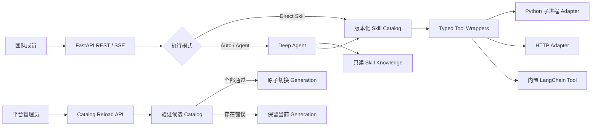

# SAGE：让团队 Skills 成为可治理的 Agent API

> **项目暂定名：** SAGE（Skill Agent Governance Engine）  
> **一句话定位：** 为 Agent Skills 提供 GitOps 式验证、不可变发布、Direct/Agent 一致执行与失败回滚。确定性任务零 LLM 直达，复杂任务由 Deep Agent 渐进发现并编排。  
> **当前状态：** 可运行原型；执行工作台和本地治理控制面闭环已实现。  
> **文档用途：** 团队讨论、Hackathon 报名、技术决策、Demo 设计与路演准备。

---

## 1. 执行摘要

这个想法**适合作为 Hackathon 项目**，而且具备冲击高名次的潜力，但获胜点不能只是“用 LangChain 调用几个 Skills”。类似的 Agent Tool Calling Demo 已经很多，评委很难仅因技术框架而记住它。

SAGE 真正有竞争力的命题是：

> **如何把个人或小团队掌握的 AI Skill，从本地文件和脚本，升级为其他成员能够安全复用、持续更新、稳定运行的团队能力。**

项目应集中证明三个核心价值：

1. **确定性直达**：明确知道要调用哪个 Skill 时，不经过 LLM，降低延迟、成本和不确定性。
2. **渐进式编排**：复杂自然语言任务由 Deep Agent 识别相关 Skill，只加载必要指令并组合执行。
3. **安全升级与恢复**：管理员可以运行时发布新 Skill；合法版本原子生效，非法版本自动拒绝，正在执行的请求不受影响。

冠军级 Demo 的重点不是展示最多功能，而是让评委在三分钟内看到一条完整证据链：

```text
一个成员创建 Skill
  -> 平台验证并发布
  -> 其他成员通过一个 API 使用
  -> Agent 自动组合多个 Skill
  -> Skill 在线升级且不中断请求
  -> 错误升级被拒绝，旧版本继续服务
```

---

## 2. 我们真正要解决的问题

### 2.1 当前团队中的能力孤岛

团队成员已经在用 AI 提升效率，但能力通常散落在不同位置：

- 某个人电脑上的 Prompt 和 `SKILL.md`
- Python、PowerShell 或命令行脚本
- LangChain Tool 或内部 Agent
- 部门内部 HTTP API
- 文档中的操作流程和专家经验
- 只能在特定环境中运行的诊断工具

这些能力往往面临共同问题：

| 问题 | 直接影响 |
|---|---|
| 使用门槛高 | 其他成员需要安装环境、理解参数甚至阅读代码 |
| 缺少统一入口 | 每种 Skill 都有不同调用方式 |
| 无法自动发现 | 用户必须提前知道该使用哪个 Skill |
| 更新困难 | 更新代码或 Prompt 后需要重启、重新部署或通知所有用户 |
| 缺少治理 | 超时、权限、输入输出、网络访问通常只写在说明中 |
| 缺少可观测性 | 无法回答调用了什么、耗时多久、失败在哪里 |
| Agent 不可控 | 所有任务都交给 LLM，成本和结果不稳定 |

### 2.2 三类核心用户

**能力拥有者**

- 已经写好了 Skill、Prompt、脚本或内部 API。
- 希望让更多人使用，但不想为每个 Skill 单独开发服务。

**平台管理员**

- 需要验证 Skill 的入口、Schema、权限、超时和副作用。
- 希望发布失败不影响现有用户。

**普通团队成员**

- 只希望描述需求并获得结果。
- 不应该关心 Skill 安装、运行环境和底层模型。

### 2.3 核心用户故事

> 作为团队成员，我希望通过统一 API 提交自然语言请求，让系统自动选择并组合团队已有 Skills；当我明确知道目标时，也可以直接调用某个 Skill，以获得更低成本、更确定的结果。

### 2.4 企业级 AI 痛点覆盖分析

从企业 AI 应用和 Agent 工程化的角度看，这个想法解决的是一个真实但经常被忽视的问题：

> 企业通常不缺少 AI Demo，而是缺少把零散 AI 能力转化为可复用、可治理、可持续运营的组织能力的方法。

SAGE 不试图在 Hackathon 阶段解决企业 AI 的全部问题。它聚焦于从“个人 Skill”走向“团队服务”的最小闭环，并为后续企业级治理保留清晰扩展点。

#### 痛点覆盖矩阵

| 企业 AI 痛点 | SAGE 的解决机制 | 可验证证据 | 当前覆盖度 |
|---|---|---|---|
| Prompt、脚本和内部 API 形成能力孤岛 | 统一 Skill 包、Catalog 和 Web API | 不同形态 Skill 通过同一请求契约调用 | **直接解决** |
| 每项能力都重复开发服务 | Adapter 统一 Python、Tool 和 HTTP 执行 | 新增 Skill 不改变上层 API | **直接解决** |
| 使用者必须了解实现与运行环境 | 自然语言 Auto 模式和类型化 Direct 模式 | 用户无需安装原 Skill 环境 | **直接解决** |
| 所有请求都经过 LLM，成本和结果不稳定 | 确定性任务走 Direct Skill | 运行元数据显示 `model_calls: 0` | **直接解决** |
| Skills 数量增加后上下文膨胀 | Deep Agent 渐进加载 Skill 元数据、指令和资源 | 只读取被选中的 `SKILL.md` | **直接解决** |
| Tool 权限和边界只写在 Prompt 中 | `skill.yaml` 强制 Schema、超时、网络和副作用政策 | 非法输入、入口和 endpoint 被服务器拒绝 | **MVP 验证** |
| Skill 更新需要重启且容易影响现有请求 | Catalog Generation、原子切换和会话版本绑定 | 旧请求继续运行，新请求使用新版本 | **直接解决** |
| 错误版本发布后难以恢复 | 候选 Catalog 全量验证和失败回滚 | 非法版本发布失败，Active Generation 不变 | **直接解决** |
| Agent 执行过程不可见 | REST 结果、SSE 生命周期事件和结构化运行元数据 | 可查看 Skill、Tool、耗时、预算和状态 | **部分解决** |
| 缺少用户、角色和租户级权限 | 当前仅预留鉴权和 Tool 过滤扩展点 | MVP 使用共享 Key，不具备用户身份 | **尚未解决** |
| 数据隐私、驻留和行业合规 | 支持脱敏 Skill、日志最小化和网络白名单 | 尚无完整数据分类和合规策略引擎 | **部分解决** |
| 动态代码可能危害宿主环境 | 可信目录、子进程执行和资源限制 | 子进程不是安全沙箱 | **部分解决** |
| 多实例、高可用和持久任务 | 架构可迁移至持久 Store、队列和 Sandbox | MVP 为单进程内存状态 | **尚未解决** |

#### 直接解决的高价值问题

**1. 将个人能力转化为组织资产**

能力拥有者只需维护 Skill 的知识、Schema 和执行入口；其他成员通过统一 API 使用，不再依赖原作者手工协助。这解决了企业内部 AI 能力“做得出来但传不出去”的问题。

**2. 避免过度 Agent 化**

企业系统中并非所有任务都需要模型推理。SAGE 将确定性执行与模型编排分开：已知目标直接调用，未知步骤才由 Agent 决策。这能同时降低成本、延迟和幻觉风险。

**3. 控制上下文与工具规模**

当企业拥有大量 Skills 时，把所有说明放入 System Prompt 不具备扩展性。渐进加载使模型先看到简短元数据，只有确认相关后才读取完整指令和资源。

**4. 把治理要求从文字变成代码**

Prompt 可以告诉 Agent 应该做什么，却不能成为可靠的安全边界。`skill.yaml` 将输入输出、超时、幂等性、网络目标和副作用变成服务器可执行的政策。

**5. 降低 AI 能力变更风险**

企业能力会持续变化，发布机制和运行机制同样重要。不可变 Generation、请求版本固定和失败回滚证明 SAGE 不只考虑“怎样调用”，也考虑“怎样安全演进”。

#### 部分解决但仍需生产化建设的问题

SAGE 的 Hackathon MVP 可以证明治理方向，但下列能力需要在企业部署前补齐：

- 使用 Entra ID、OIDC 或 JWT 建立真实用户身份。
- 按用户、角色、部门和租户过滤可见及可执行 Skills。
- 建立数据分类、敏感信息处理、驻留和保留策略。
- 使用容器或远程 Sandbox 替代宿主机子进程。
- 对 Skill 包实施签名、审批、恶意文件扫描和供应链审计。
- 使用数据库、Redis 或持久化 LangGraph Checkpointer 保存会话和审计记录。
- 引入任务队列、幂等键、重试政策、多实例协调和灾难恢复。
- 对高风险、写入型或高成本操作增加 Human-in-the-loop。
- 建立 Skill 离线评测、回归测试、质量门禁和版本退役机制。
- 对模型与工具实施成本预算、配额、告警和部门级计量。

#### 企业级定位边界

不建议对外宣称：

> SAGE 已经解决企业 AI 治理的全部问题。

建议使用更准确、可信的表述：

> **SAGE 验证了企业可信 AI 能力从开发、发现、执行到安全升级的最小闭环，是连接个人 Skills 与企业 AI 平台的治理层原型。**

企业不会因为使用了某个 Agent 框架而采用产品。企业最终关心的是：

- 能力接入需要多久？
- 有多少成员可以安全复用？
- 可以减少多少不必要的模型调用？
- 出错和发布失败时是否可控？
- 谁调用了什么能力，结果和成本能否追踪？

因此，Hackathon 的验证重点应始终围绕可测量的组织价值，而不是框架功能数量。

---

## 3. 方案概述

### 3.1 Skill 包

每个 Skill 使用两个互补文件：

```text
skills/
└── pii-redact/
    ├── SKILL.md
    ├── skill.yaml
    ├── scripts/
    ├── references/
    └── assets/
```

**`SKILL.md`：告诉 Agent“为什么和怎样使用”**

- Skill 名称和自然语言描述
- 适用场景与触发关键词
- 操作步骤、边界和示例
- 需要按需读取的参考资料

**`skill.yaml`：告诉服务器“允许怎样执行”**

- 版本和执行类型
- 入口或服务器端 endpoint alias
- 输入与输出 JSON Schema
- 超时、幂等性和副作用等级
- 文件、网络和环境变量策略

这种拆分是项目的重要创新点：

> Prompt 负责指导智能，Manifest 负责约束执行。安全边界不依赖模型自觉。

### 3.2 两条执行路径

#### Direct Skill

客户端明确指定 Skill：

```text
请求 -> Registry -> Schema 校验 -> Adapter -> 结果
```

特点：

- 不调用模型
- 延迟和成本较低
- 参数与结果可验证
- 适合自动化系统集成

#### Deep Agent

客户端只描述目标：

```text
请求 -> Deep Agent -> 渐进加载 SKILL.md -> 选择/组合 Tools -> 结果
```

特点：

- 适合目标明确但步骤不确定的任务
- 可组合多个 Skills
- 只在需要时读取完整 Skill 指令和参考材料
- 通过预算、超时和工具白名单限制自主性

### 3.3 总体架构



### 3.4 热更新语义

“热更新”不是看到文件就立即执行，而是管理员主动触发的受控发布：

1. 扫描可信目录。
2. 校验 `SKILL.md`、`skill.yaml`、Schema、入口和安全策略。
3. 构建完整候选 Catalog。
4. 运行轻量自检。
5. 全部成功后原子切换到新 Generation。
6. 任一步失败时保留旧 Generation。

每个请求在开始时固定一个 Generation：

- 正在运行的请求继续使用旧版本。
- 新请求使用新版本。
- 已存在的会话保持版本一致，避免对话中途行为漂移。

---

## 4. 技术可行性

### 4.1 可用技术

| 能力 | 建议技术 | 可行性判断 |
|---|---|---|
| Web API | FastAPI + Pydantic | 成熟、开发速度快、自动生成 OpenAPI |
| Agent 编排 | LangChain Deep Agents | 支持 Skills 渐进加载、工具调用、子 Agent 和上下文管理 |
| 状态与运行时 | LangGraph | 支持 Checkpointer、线程状态、预算和流式事件 |
| Skill 规范 | Agent Skills `SKILL.md` | 已有清晰目录和 frontmatter 规范 |
| 执行 Manifest | 自定义 `skill.yaml` | Pydantic 可严格验证，实施成本可控 |
| HTTP Skill | HTTPX AsyncClient | 支持连接池、超时、流式响应和 MockTransport |
| 动态 Python | `asyncio` 子进程 + JSON stdin/stdout | 足以验证生命周期隔离，但不是安全沙箱 |
| 流式输出 | FastAPI SSE | 适合展示 Agent、Tool 和结果进度 |
| 离线测试 | pytest + Fake Chat Model + MockTransport | 可避免现场依赖网络和真实模型服务 |

### 4.2 为什么能够在 Hackathon 内完成

项目不需要从零实现 Agent Runtime，而是组合成熟组件，把主要开发精力放在差异化部分：

- Skill 包加载与验证
- 统一 Adapter 契约
- Direct 与 Agent 双路径
- Catalog Generation 与原子刷新
- 安全事件流和失败恢复

### 4.3 时间盒建议

#### 24 小时核心版

- 一个主案例
- `SKILL.md + skill.yaml` 加载
- Direct 与 Auto 两种模式
- Python/内置 Tool 两种执行方式
- 基础 SSE
- Catalog 刷新成功与失败回滚

#### 48 小时推荐版

- 四种 Skill 形态：Prompt、Python、LangChain Tool、HTTP
- Deep Agent 渐进加载
- Generation 可视化
- 超时、工具预算和取消
- 离线评测数据
- 三分钟完整 Demo 和备用录屏

#### 72 小时加分版

- 小型运行控制台
- 案例画廊
- 更完整的可观测性
- MCP Adapter 概念验证
- 一个需要人工批准的高风险 Skill

### 4.4 必须诚实说明的限制

- 子进程是生命周期隔离，不是恶意代码安全沙箱。
- MVP 只接受管理员可信目录中的 Skill。
- 内存 Checkpointer 不支持生产级多实例和重启恢复。
- SSE 事件不持久化，不支持断线重放。
- Deep Agent 仍可能选择错误 Skill，关键业务结果不能只靠模型判断。

这些限制不会削弱 Demo，反而证明团队理解 Agent 系统真正的工程边界。

---

## 5. 有效性与价值验证

### 5.1 对团队的价值

**复用专家能力**

把个人经验从“只有作者会用”变成“全团队通过 API 使用”。

**降低接入成本**

使用者不需要安装原始环境，也不需要理解 Skill 的实现细节。

**减少不必要的模型调用**

确定性任务直接执行；只在需要推理和组合时调用模型。

**缩短能力发布周期**

Skill 可以独立更新，不必为每项能力重复开发完整 Web 服务。

**提高 Agent 可治理性**

输入输出、超时、网络、版本和副作用成为服务器可执行政策。

### 5.2 不能提前虚构的指标

路演中不要声称“效率提高 80%”或“成本降低 90%”，除非现场完成了可复现实验。应先定义指标，再展示实测结果。

| 指标 | 测量方法 | Demo 目标 |
|---|---|---|
| Direct 模型调用次数 | 统计运行元数据 | 必须为 0 |
| Skill 选择正确率 | 预设任务与实际调用对比 | 展示真实样本结果 |
| 渐进加载率 | 统计读取的 `SKILL.md` 数量 | 只加载与任务相关的 Skill |
| 端到端延迟 | 记录 P50/P95 | 对比 Direct 与 Agent，不预设数字 |
| Token 使用量 | 模型 usage metadata | 对比全部加载与渐进加载 |
| 刷新原子性 | 故意加载非法版本 | Active Generation 不变化 |
| 请求版本一致性 | 记录开始/结束 Generation | 同一请求不可漂移 |
| SSE 完整性 | 自动检查事件序列 | 每次运行只有一个终止事件 |
| 安全拒绝率 | 路径穿越、非法 URL 等测试 | 所有恶意测试均被拒绝 |

### 5.3 建议的离线实验

准备 20 至 30 个固定任务：

- 10 个确定性 Direct Skill 任务
- 10 个单 Skill Agent 任务
- 10 个多 Skill 编排任务

比较三种方式：

1. 所有任务都走普通 Agent。
2. SAGE Auto 模式。
3. SAGE Direct Skill 模式。

记录：

- 延迟
- 模型调用次数
- Token 使用量
- Skill/Tool 选择结果
- 完成率和错误类型

展示真实结果时必须注明模型、硬件、样本数和测试条件。

---

## 6. 为什么它有冠军潜力

### 6.1 创新性

普通 Agent Demo 解决的是：

> 模型如何调用一个工具？

SAGE 解决的是：

> 一个团队如何把经过验证的一组 Agent Skills 发布为不可变版本，并保证 Direct 与 Agent 请求使用一致版本、失败时能够立即回滚？

关键创新组合：

- 标准 `SKILL.md` 与可执行政策绑定
- 结构校验、行为评测和安全检查组成发布门禁
- Direct 与 Agent 双路径
- 不可变 Catalog Generation
- 请求与会话的 Generation 固定
- 候选版本全量验证、原子切换和失败回滚

Skill 规范、Agent Harness、MCP 网关和评测工具都已有成熟项目。SAGE 的创新不应建立在重复实现这些组件上，而应建立在把它们连接为一个可验证、可发布、可固定版本、可回滚的企业交付闭环。

### 6.2 商业与组织价值

- 让企业内部 AI 能力从个人资产变成组织资产。
- 降低重复开发 Skill Web 服务的成本。
- 为后续权限、审计、计费和 Skill Marketplace 建立基础。
- 允许不同语言和团队独立开发能力。

### 6.3 技术深度

评委能够现场看到，而不是只从架构图听到：

- 类型化输入输出
- 异步流式执行
- 并发下的不可变快照
- 线程与 Generation 绑定
- 超时、预算、取消
- 非法版本的事务式回滚
- 模型与执行权限分离

### 6.4 Demo 表现力

项目天然拥有四个视觉化瞬间：

1. `model_calls: 0`：简单任务不需要 LLM。
2. SSE 时间线：Agent 按需加载并调用多个 Skills。
3. Generation 切换：旧请求和新请求同时运行不同版本。
4. 非法版本回滚：刷新失败但服务继续工作。

### 6.5 评审维度映射

| 评审维度 | SAGE 的证据 | 应重点讲什么 |
|---|---|---|
| 创新性 | 评测门禁、不可变 Generation、请求版本固定 | Agent Skills 的事务式交付，而非另一个 Tool Gateway |
| 业务价值 | 专家能力通过统一 API 复用 | 能力拥有者一次开发，全团队使用 |
| 技术深度 | 快照、回滚、预算、取消 | Agent 能力进入真实系统需要治理层 |
| 完成度 | 离线可运行的完整闭环 | 不依赖外网，不用 PPT 假装功能存在 |
| 用户体验 | 自然语言 + Direct API + SSE | 同时服务人和自动化系统 |
| 可扩展性 | Adapter 与 MCP 路线 | 新执行形态不改变上层 API |

---

## 7. 生态调研、竞品与定位修正

### 7.1 调研结论

截至 2026 年 8 月 17 日，GitHub 和相关官方站点已经存在成熟的 Agent Skills 规范、Skill 市场、Agent Harness、MCP Registry/Gateway、工具平台、评测工具和 Skill 演进项目。

本轮调研没有发现一个主流项目明确同时提供以下完整组合：

```text
Agent Skills 原生支持
+ Direct / Agent 双路径
+ 结构与行为评测门禁
+ 不可变 Catalog Generation
+ 请求/会话版本固定
+ 候选版本原子激活与失败回滚
```

这不是对整个开源生态“绝对不存在”的证明，但说明 SAGE 仍有可验证的差异化空间。与此同时，统一 Registry、Gateway、Tool Routing、Skill 分享或 Agent SSE 本身都已经不是空白市场，不能再作为主要创新声明。

### 7.2 已核实的相关项目

| 项目 | 已覆盖能力 | 与 SAGE 的关系和启示 |
|---|---|---|
| [Agent Skills](https://github.com/agentskills/agentskills) | `SKILL.md` 开放规范、渐进披露和参考验证器 | 直接采用标准和 `skills-ref`，不要重新发明 Skill 基础格式 |
| [Anthropic Skills](https://github.com/anthropics/skills) | 官方 Skill 示例与可移植内容包 | 作为 Skill 作者体验和目录结构参考 |
| [LangChain Deep Agents](https://github.com/langchain-ai/deepagents) | Skills、Tools、子 Agent、Memory、Sandbox 和流式事件 | 作为 SAGE 的 Agent 执行引擎，而不是重复实现 Harness |
| [LangSmith Fleet Skills](https://docs.langchain.com/langsmith/fleet/skills) | 私有/共享 Skills、工作区同步、AI 创建和本地拉取 | 已覆盖团队 Skill 分享；SAGE 必须突出事务式发布和执行一致性 |
| [ToolHive](https://github.com/stacklok/toolhive) / [Registry Server](https://github.com/stacklok/toolhive-registry-server) | MCP Runtime、Gateway、容器隔离、Skill/Plugin 版本发现、OIDC、审计和多来源同步 | 企业治理方向的强竞品；可作为未来 MCP 执行基础设施 |
| [Microsoft MCP Gateway](https://github.com/microsoft/mcp-gateway) | Tool/MCP Server 注册部署、动态路由、Entra ID、Agent/Session、SSE 和管理界面 | 运行时层面最接近 SAGE，证明“统一 Tool + Agent API”不能作为独有卖点 |
| [IBM ContextForge](https://github.com/IBM/mcp-context-forge) | MCP/A2A/REST/gRPC Gateway、Registry、RBAC、插件、Guardrails 和 OTel | 可复用的企业连接与治理层，不以 Agent Skills 事务发布为核心 |
| [Dify](https://github.com/langgenius/dify) | Agent、Workflow、RAG、Tools、API 和 LLMOps | SAGE 若范围过宽，会被理解成小型 Dify；必须保持窄而深 |
| [Composio](https://github.com/ComposioHQ/composio) | 大规模工具目录、动态工具发现、用户级认证、Sandbox、MCP 和多框架 Adapter | 可承担远程 Tool 与授权层，SAGE 不应自建 SaaS 集成目录 |
| [AAS Core](https://github.com/sickn33/agentic-awesome-skills) | Skill Catalog、Agent 自主选择、Stack Manifest、验证和不可变计划预览 | 与 Catalog/计划思想接近，但 Apply 和 Recovery 仍明确属于实验能力 |
| [skills.sh](https://skills.sh/) | Skill 检索、安装、排行榜、Packs 和安全审计 | 解决公开发现与分发，不负责企业请求运行和版本固定 |
| [agent-skills-eval](https://github.com/darkrishabh/agent-skills-eval) | 有/无 Skill 对照评测、Judge、Tool 断言、CI 和 HTML 报告 | 适合作为 SAGE 发布门禁，不应重新实现完整评测框架 |
| [Tencent SkillHone](https://github.com/Tencent/SkillHone) | 整个 Skill 目录持续优化、回归评测和 Git Issue/PR/Wiki 审计 | 可作为未来 Skill 改进环，与运行时发布互补 |
| [MDA](https://github.com/sno-ai/mda) | 版本、依赖、内容摘要、签名、信任策略和多格式编译 | 可用于供应链可信；SAGE 的执行 Manifest 应保持最小并避免与其元数据重复 |

### 7.3 最接近的竞争面

**ToolHive：企业 Skill/MCP 治理**

ToolHive Registry Server 已支持 MCP Server、Skill 和 Plugin 的版本发现、OIDC/JWT 可见性、角色管理、审计、多来源同步和 PostgreSQL。完整平台还包括容器 Runtime、Gateway 和 Portal。因此，SAGE 不应试图在 Hackathon 中复制一套企业级 MCP 平台。

**Microsoft MCP Gateway：统一 Tool 与 Agent Runtime**

该项目已经提供 Tool 和 MCP Server 的 REST 控制面、容器部署、动态 Tool 路由、Entra ID 权限，以及 Agent/Session 和 SSE 事件。它与 SAGE 原先的“统一 API + Agent + Tool”叙事高度重叠。

**LangSmith Fleet：团队 Skill 分享**

Fleet 已提供私有与工作区共享 Skills，并让多个 Agent 自动同步更新。因此，“让团队成员分享 Skills”是必要价值，但不是独有创新。

**AAS Core：Catalog、选择和不可变计划**

AAS Core 已把 Agent 选择转化为可验证 Stack Manifest 和不可变计划，不过其事务式 Apply/Recovery 仍是实验能力。这进一步说明 SAGE 最值得证明的是运行中的一致性和可靠切换，而不是只生成计划。

### 7.4 SAGE 应保留的差异化

经过竞品修正后，SAGE 的核心不再是“又一个 Registry 或 Gateway”，而是：

> **Agent Skills 的事务式发布与运行控制层。**

重点证明以下闭环：

1. 将一组 Skills 作为一个发布单元，而不是逐文件立即生效。
2. 发布前依次执行格式验证、执行契约验证、安全检查和行为评测。
3. 构建带内容摘要的不可变 Generation。
4. Direct 和 Agent 请求捕获同一个 Generation。
5. 请求和会话在执行期间保持版本固定。
6. 候选 Generation 只有全部通过后才原子激活。
7. 激活失败或评测退化时继续使用旧 Generation。
8. 用统一运行证据展示模型调用、Skill 选择、版本、耗时与终止状态。

这一定位可以概括为：

> **GitOps-style deployment and runtime governance for Agent Skills.**

### 7.5 复用优先，而不是重复造轮子

建议的组件策略：

| 层次 | 优先复用 | SAGE 自己实现的最小部分 |
|---|---|---|
| Skill 格式 | Agent Skills + `skills-ref` | 企业执行绑定的最小扩展 |
| Agent 编排 | Deep Agents | Generation 注入、预算和结果归一化 |
| MCP 执行 | ToolHive、Microsoft MCP Gateway 或 ContextForge | Adapter 和版本引用 |
| 行为评测 | agent-skills-eval | 发布门禁和结果判定策略 |
| 内容可信 | MDA/Sigstore 思路 | 内容摘要和信任政策接入 |
| 持续优化 | SkillHone | 接收已审批的新候选版本 |
| 事务发布 | 暂未发现完整同构组件 | Candidate、Generation、Pin、Activate、Rollback |

Hackathon MVP 可以使用本地简化实现证明最后一行，未来再替换底层组件。这样项目是在协调现有生态，而不是与成熟开源平台正面比拼功能数量。

### 7.6 修正后的推荐话术

不再建议使用：

> SAGE 位于 MCP、工作流和 API Gateway 之上，统一治理所有能力。

建议改为：

> **SAGE 复用现有 Agent Skills、Deep Agent、MCP Gateway 和评测生态，为它们补上从候选 Skill 到稳定生产 Generation 的事务式交付闭环。**

---

## 8. 英雄案例：客户反馈智能处理

> **定位：建议作为现场真实演示。**  
> **选择原因：** 行业中立、数据容易模拟、风险低，并能自然展示四种 Skill 形态。

### 8.1 故事背景

产品经理收到一批混合客户反馈，其中包含个人信息、缺陷描述、功能建议和退款诉求。过去需要人工整理、分类、查政策，再形成行动摘要。

用户只发送一句话：

> 请处理这批客户反馈：先移除敏感信息，分类问题，检查对应处理政策，最后生成一份给产品和客服团队的行动摘要。

### 8.2 Skills 组合

| Skill | 形态 | 职责 | 为什么这样设计 |
|---|---|---|---|
| `pii-redact` | Python 子进程 | 确定性脱敏 | 可直接调用，证明零 LLM 路径 |
| `ticket-classify` | LangChain Tool | 分类反馈 | 展示类型化本地 Tool |
| `policy-check` | HTTP Skill | 查询模拟政策 | 展示远程团队能力接入 |
| `brief-maker` | Prompt Skill | 生成行动摘要 | 展示 `SKILL.md` 渐进加载 |

### 8.3 叙事推进

**第一幕：能力可以工作**

直接调用 `pii-redact`，界面显示：

```text
mode: direct
skill: pii-redact
model_calls: 0
adapter: python-subprocess
```

**第二幕：能力可以组合**

使用自然语言请求，SSE 显示安全事件：

```text
run.started
skill.loaded: brief-maker
tool.started: pii-redact
tool.completed: pii-redact
tool.started: ticket-classify
tool.completed: ticket-classify
tool.started: policy-check
tool.completed: policy-check
run.completed
```

**第三幕：能力可以安全升级**

把 `brief-maker` 从 v1 更新到 v2：

- v1 只输出摘要。
- v2 增加负责人和优先级建议。

旧请求保持 Generation 12，新请求进入 Generation 13。

**第四幕：系统会安全失败**

故意放入名称不一致或非法 endpoint 的 v3：

```text
candidate_generation: 14
swap: rejected
active_generation: 13
reason: manifest_validation_failed
```

旧版本继续处理请求。

---

## 9. 用于增强叙事的迁移案例

这些案例用于证明平台复用能力。只有实际实现的案例才能标记为“现场真实演示”。

### 9.1 IT/IIS 故障响应

> **定位：未来适用场景；若已有可用 Skills，可升级为可选现场案例。**

故事：

> 值班工程师收到“网站间歇性返回 500”的告警。系统自动选择服务健康、IIS 日志、HTTP Error、事件日志和故障摘要 Skills，输出证据、可能原因和下一步建议。

价值：

- 把资深工程师的排障顺序固化为团队 Skill。
- 新成员不需要先学习所有诊断工具入口。
- 可以衡量“首次形成诊断假设的时间”，而不是虚构节省比例。

### 9.2 软件发布门禁

> **定位：可选样例。**

故事：

> 发布负责人提交版本号，系统运行测试、依赖漏洞检查、政策校验和 Release Notes 生成，最后输出 Go/No-Go 建议。

价值：

- 确定性检查使用 Direct Skills。
- Deep Agent 负责收集证据与整理解释。
- 高风险发布动作未来可增加人工审批。

### 9.3 财务或费用合规审核

> **定位：未来适用场景。**

故事：

> 员工提交结构化费用数据，系统校验字段、脱敏个人信息、查询费用政策并生成审计摘要。

价值：

- 确定性规则和自然语言政策解释相结合。
- 所有政策查询和执行结果可追踪。
- 不宣称自动做财务决策，最终审批仍由人完成。

### 9.4 企业知识交付

> **定位：未来适用场景。**

故事：

> 销售人员询问某产品能否满足客户需求。Agent 选择产品知识、合规边界、报价政策和方案模板 Skills，生成带来源的初稿。

价值：

- 不把全部内部文档一次性放入 Prompt。
- 各部门可以独立维护自己的 Skill。
- 更新政策后新请求立即使用新版本。

### 9.5 案例共性矩阵

| 案例 | Direct 路径 | Agent 路径 | 主要 Adapter | 可见治理证据 |
|---|---|---|---|---|
| 客户反馈 | 脱敏 | 分类、政策、摘要编排 | Python、Tool、HTTP、Prompt | Generation、Schema、SSE |
| IT 故障 | 单项日志分析 | 多源诊断编排 | Script、HTTP | 超时、只读、证据链 |
| 发布门禁 | 测试和策略检查 | 汇总 Go/No-Go 建议 | Process、HTTP | 工具预算、人工审批路线 |
| 财务合规 | 字段和规则校验 | 政策解释与摘要 | Tool、HTTP | 脱敏、审计、幂等性 |
| 知识交付 | 指定资料查询 | 跨部门能力组合 | Prompt、HTTP | 版本、来源、权限路线 |

重复出现的基础设施正是平台复用性的证据。

---

## 10. 三分钟冠军级 Demo 剧本

### 0:00-0:20：从用户痛点开始

不要先说 LangChain、Deep Agents 或 FastAPI。

建议开场：

> 我们团队已经做了很多有价值的 AI Skills，但它们都在不同成员的电脑、脚本和服务里。真正的问题不是再写一个 Agent，而是怎样让这些能力被全团队安全复用。

### 0:20-0:45：Direct Skill

- 调用 `pii-redact`。
- 展示脱敏结果。
- 放大显示 `model_calls: 0`。

讲解：

> 确定性任务不应该为了“Agent 化”而强制经过模型。

### 0:45-1:30：Deep Agent 自动编排

- 输入客户反馈处理请求。
- 展示 SSE 时间线。
- 强调仅加载匹配的 `SKILL.md`。
- 显示最终行动摘要。

讲解：

> 用户不需要知道四个工具的名字，Agent 也不需要一开始读取所有 Skill 内容。

### 1:30-2:10：主要 Wow Moment

- 一个请求保持在 v1。
- 管理员发布 `brief-maker` v2。
- 新请求显示 v2 新字段。
- 两个请求显示不同但一致的 Generation。

讲解：

> 能力升级了，但正在运行的任务不会突然改变行为。

### 2:10-2:40：失败恢复

- 发布非法 v3。
- 刷新被拒绝。
- Active Generation 不变。
- 立即再次成功调用 v2。

讲解：

> 我们展示的不只是 AI 成功时有多聪明，还展示失败时系统是否可靠。

### 2:40-3:00：收束

> SAGE 不是让 Agent 看起来更聪明，而是让团队已有能力可以被安全地发现、调用、升级和恢复。

---

## 11. 团队沟通时如何讲清楚

### 11.1 使用统一讲解顺序

每次内部介绍都使用六步结构：

1. **Why**：团队 Skills 是能力孤岛。
2. **Who**：能力拥有者、管理员、普通成员。
3. **What**：统一 Skill Runtime 和 Web API。
4. **How**：Direct、Deep Agent、Adapter、Catalog。
5. **Proof**：零模型调用、渐进编排、原子升级、失败回滚。
6. **Boundary**：可信目录、非安全沙箱、单进程 MVP。

### 11.2 不同长度的话术

#### 15 秒版本

> SAGE 把团队成员做的 Prompt、脚本和 API 包装成统一 Skills。简单任务直接执行，复杂任务由 Deep Agent 自动组合，并支持安全热更新和失败回滚。

#### 30 秒版本

> 现在团队里的 AI 能力散落在个人电脑、脚本和内部服务中，其他人很难复用。SAGE 用 `SKILL.md` 描述能力语义，用 `skill.yaml` 约束执行，再通过统一 Web API 提供 Direct 和 Agent 两条路径。它不仅让 Agent 会调用工具，还让团队可以验证、发布、升级和恢复这些能力。

#### 90 秒版本

> 很多 Agent 项目从聊天界面开始，但我们从团队协作问题开始：一个人做好的 Skill，怎样让其他成员不安装环境就能使用？SAGE 把 Prompt、Python、LangChain Tool 和 HTTP API 转换成统一的版本化 Skill。明确任务走 Direct 路径，不调用 LLM；复杂任务由 Deep Agent 根据元数据发现 Skill，并在需要时读取完整说明。管理员可以在线刷新 Catalog，系统先验证完整候选版本，再原子切换；错误版本不会影响当前服务，运行中的请求保持原版本。它是 Agent 与团队现有能力之间的治理层。

### 11.3 团队统一术语

| 术语 | 团队统一定义 | 不建议的模糊说法 |
|---|---|---|
| Skill | 知识、资源、执行策略组成的能力包 | 一个 Prompt 或任意函数 |
| Tool | Agent 可以调用的类型化程序接口 | Skill 的同义词 |
| Adapter | 执行 Tool 对应能力的技术连接器 | 随便写的 wrapper |
| Agent | 根据目标选择和组合 Skills/Tools 的模型循环 | 所有 API 请求 |
| Catalog | 当前可用 Skill 的不可变版本快照 | 一个可随意修改的字典 |
| Generation | 一次完整、已验证的 Catalog 版本 | 单个 Skill 的版本号 |
| 热更新 | 管理员触发、验证后原子切换 | 自动执行目录中新文件 |
| 沙箱 | 能隔离文件、进程、网络和资源的安全边界 | 普通 subprocess |

### 11.4 面向不同听众调整重点

**对产品和业务成员**

- 讲能力复用、使用门槛和上线速度。
- 少讲中间件和 LangGraph 节点。

**对工程师**

- 讲 Schema、Adapter、快照、取消和测试。
- 展示直接执行与 Agent 执行的边界。

**对安全或管理人员**

- 讲可信来源、白名单、只读 Skill、审计和失败回滚。
- 主动说明 subprocess 不是沙箱。

**对评委**

- 先讲真实问题和可见效果。
- 再用技术架构证明不是一次性 Demo。
- 最后说明清晰边界和演进路线。

### 11.5 团队讨论会议建议

建议开一次 45 分钟决策会：

| 时间 | 议题 | 输出 |
|---:|---|---|
| 0-5 分钟 | 每人复述一句话定位 | 选出统一版本 |
| 5-15 分钟 | 主案例是否足够真实 | 固定英雄故事和数据 |
| 15-25 分钟 | MVP 必须证明什么 | 固定三项核心证据 |
| 25-35 分钟 | 最大现场风险 | 制定离线与录屏备份 |
| 35-40 分钟 | 角色与接口 | 明确四人职责和交付物 |
| 40-45 分钟 | 模拟评委质疑 | 记录 Q&A 和待验证假设 |

每次讨论新功能时都问：

> 它是否增强“确定性直达、渐进编排、安全升级”三个核心证据之一？

如果不能，应推迟到 Roadmap。

---

## 12. 四人团队建议分工

### 成员 A：API 与流式体验

- FastAPI 生命周期
- REST/SSE 契约
- 鉴权、错误模型、健康检查
- Demo 控制台或终端输出

### 成员 B：Skill Loader 与 Catalog

- `SKILL.md` / `skill.yaml` 校验
- Catalog Generation
- 原子刷新和失败回滚
- 并发与版本一致性测试

### 成员 C：Deep Agent 与 Adapter

- Deep Agents 集成
- Tool 生成
- Python/HTTP Adapter
- 超时、预算和取消

### 成员 D：案例、评测与路演

- 英雄案例 Skills
- 固定任务集和实测指标
- README、架构图和 Pitch
- Demo 排练与备用录屏

最后 10% 至 15% 的时间应冻结功能，只做：

- 修复阻断问题
- 重复排练
- 收集真实指标
- 准备离线数据
- 录制备用 Demo

---

## 13. 常见质疑与建议回答

### “这不就是 Tool Calling 吗？”

> Tool Calling 解决模型如何发起一次工具调用。SAGE 还处理团队 Skill 的发现、执行契约、版本、发布、回滚、Direct 调用和统一观测。Tool Calling 是其中一个执行环节。

### “为什么不用 MCP？”

> MCP 是很好的工具互操作协议，可以成为 SAGE 的一种 Adapter。SAGE 关注的是协议之外的 Skill 语义、发布治理、版本一致性和执行政策，两者可以组合。

### “为什么需要 `skill.yaml`，`SKILL.md` 不够吗？”

> `SKILL.md` 适合模型理解，但超时、Schema、endpoint 和副作用不能只依赖自然语言。`skill.yaml` 把这些要求变成服务器可以强制执行的政策。

### “动态 Python 安全吗？”

> MVP 只接受管理员可信目录。子进程用于故障和生命周期隔离，不宣称是安全沙箱。接收不可信 Skill 前必须迁移到容器或远程 Sandbox，并限制网络和密钥。

### “为什么不全部走 Agent？”

> 已知目标的确定性任务没有必要支付模型成本和承担选择不确定性。Direct 与 Agent 双路径可以同时服务自动化系统和自然语言用户。

### “和工作流平台有什么不同？”

> 工作流适合提前确定的步骤；SAGE 允许 Agent 根据上下文选择和组合能力。对于高风险固定流程，未来也可以把工作流作为一个受控 Skill。

### “这个方案能生产使用吗？”

> Hackathon MVP 证明核心架构和价值，不声称已经生产就绪。生产化还需要身份授权、持久化、分布式执行、真正沙箱、审计和高可用。

---

## 14. 容易失分的地方

1. **从框架开始介绍**：评委先听到一串技术名词，却不知道用户问题。
2. **只展示聊天**：看起来像普通 Agent Wrapper。
3. **功能过多**：四种 Adapter 都没做完整，反而不如两种做透。
4. **没有失败路径**：无法证明可靠性和技术深度。
5. **夸大安全性**：把 subprocess 描述为沙箱会降低可信度。
6. **把未来案例说成已实现**：评委追问时容易失去信任。
7. **没有实测数据**：只说“更快、更便宜”，没有测试方法。
8. **过度依赖外网**：模型、HTTP Skill 或演示数据现场失效。
9. **把 MCP 当竞争对手**：忽略了两者可以互补。
10. **缺少视觉证据**：热更新和回滚只在口头描述，没有界面或日志体现。

---

## 15. 范围优先级

### P0：必须完成

- 一个真实可运行的英雄案例
- Direct Skill 且 `model_calls = 0`
- Deep Agent 自动组合至少两个 Skills
- SSE 安全事件流
- Catalog 原子刷新
- 非法刷新回滚
- 固定离线输入和备用 Demo

### P1：强烈建议

- 四种 Skill 形态中至少三种
- Generation 可视化
- 超时和工具预算
- 真实评测结果
- 一个迁移案例的最小可运行样例

### P2：时间充足再做

- MCP Adapter
- 精美管理控制台
- 持久化存储
- 自定义子 Agent
- 人工审批流程
- Skill Marketplace

---

## 16. 下一步团队决策清单

- [ ] 是否认可 SAGE 的一句话定位？
- [ ] 是否确认“客户反馈智能处理”为英雄故事？
- [ ] 哪些案例是现场真实演示，哪些只进入 Roadmap？
- [ ] 比赛实际时间是 24、48 还是 72 小时？
- [ ] 可使用哪个稳定且支持 Tool Calling 的模型？
- [ ] 是否允许现场联网？离线备份是什么？
- [ ] P0 功能的完成标准是什么？
- [ ] 哪位成员负责最终范围决策？
- [ ] 哪位成员负责 Demo 主讲和操作？
- [ ] 评测任务集和数据由谁准备？
- [ ] 哪个时间点冻结功能并开始排练？

---

## 17. 最终 Pitch 文案

### 标题

**SAGE：Trusted Skills. Bounded Agents. One API.**

### 开场

> 团队已经拥有许多优秀的 AI Skills，真正缺少的不是另一个聊天机器人，而是一条让这些能力从个人电脑走向全团队的可靠路径。

### 核心价值

> SAGE 用统一 API 暴露 Prompt、脚本、LangChain Tool 和内部服务。明确任务不调用模型，复杂任务由 Deep Agent 渐进发现和组合；所有 Skill 都经过 Schema、权限、超时和版本约束。

### 技术亮点

> 新能力可以运行时发布，但只有完整验证后才原子生效。正在执行的请求保持原版本，错误版本自动回滚。

### 收尾

> **SAGE 不是让 Agent 看起来更聪明，而是让团队已有能力可以被安全地发现、调用、升级和恢复。**
