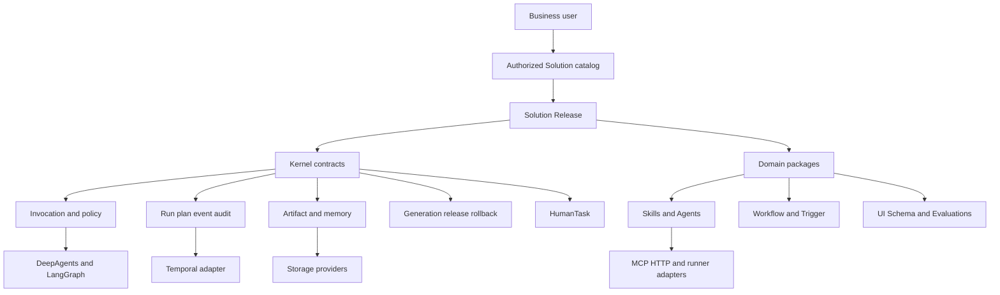

# SAGE 通用平台内核与扩展边界

## 产品定位

SAGE 是自托管的 Governed Agent Capability Platform。它治理能力包、身份、授权、执行、版本、审计和恢复，不重新实现 Agent Graph、Durable Workflow、向量数据库、OCR、爬虫或领域规则引擎。

新领域适配成功的判据是：通过公开 Solution/Skill/Agent/Workflow/MCP/Provider 契约交付，不修改 Kernel。

## 三层结构



### Kernel

- Principal、RuntimeContext、Solution Catalog
- Capability、Policy、Invocation
- Artifact、Run/Event、Plan/Step
- Memory namespace、HumanTask
- SolutionRelease、Generation、可配置 Evaluation policy、Audit/Lineage contract
- Direct、Interactive、Durable、Scheduled/Event-driven Profile contracts

### Provider 与 Integration

- DeepAgents/LangGraph Agent Runtime
- Temporal DurableExecutionPort
- MCP、HTTP、模型、Retriever、Secret、Identity Provider
- 独立 Python Runner；通过内容寻址包传输，不共享控制面状态盘
- PostgreSQL Checkpointer
- 本地 SQLite 与文件 Artifact Provider
- 未来 PostgreSQL Run/Memory/Plan Provider 和 S3/MinIO Artifact Provider

Development 在未配置 Runner 时可使用管理员可信的本地 subprocess。Production 禁止该 fallback；配置 Runner 后，`python-subprocess` Adapter 实际通过远程协议执行。Runner 重验包与输入摘要、Schema、timeout 和输出上限；部署示例使用独立 Pod、无 ServiceAccount token、只读 rootfs、临时工作目录和 deny-all egress。API readiness 会校验 Runner 协议与 profile，不可达或不匹配时返回 `503`。该实现是服务级隔离，面对敌对多租户代码时仍需升级为 per-invocation Pod/Job、gVisor/Kata 或 microVM。

### Solution Package

每个 Solution 可以包含：

```text
solution.yaml
workflow.yaml
trigger.yaml
ui.yaml
evaluation.yaml
skills/
agents/
resources/
```

`solution.yaml` 将组件 ID、版本和 SHA-256 digest 锁为一个不可变 Release。组件可独立演进，但只能通过 Candidate、Evaluate、Approve、Activate 原子进入 Catalog Generation。Evaluation 默认提供 advisory warning；严格环境可配置为 required gate。

声明组件文件路径的 Bundle 必须以 ZIP 上传。导入器限制文件数、单文件与总解压大小，拒绝绝对路径、`..`、符号链接、加密成员和可执行文件；随后解析 Workflow、Trigger、UI Schema 与 Evaluation Suite，并验证跨组件引用闭包。

## 运行模型

Transport、Reasoning Mode 和 Lifecycle Profile 是正交维度：

- Transport：HTTP、POST SSE
- Reasoning：Direct、Agent
- Lifecycle：Interactive、Durable、Scheduled、Event-driven

Direct 和 Agent 共享相同 Capability View、Policy 和 SkillExecutor。Temporal 只服务 Durable Profile，不是短任务的强依赖。通用 Worker 注册 `sage-solution-workflow`，根据锁定模板执行 Activity；HumanTask 通过 signal 恢复。模板 Workflow 提供确定性 DAG；Agent 只能在声明的节点、能力、模型/Skill/Subagent 预算和输出 Schema 内规划。

## 版本与隔离

一次运行至少固定：

```text
tenant/workspace
principal
solution_id
solution_release_id
generation_id
agent and skill versions
MCP config and schema digests
workflow and evaluation versions
```

Solution 目录在返回名称前先按角色过滤。Artifact、Memory、Run、Plan、HumanTask 和 Agent checkpoint 都使用 Solution scope。跨 Solution 共享默认拒绝；共享知识必须以显式 Capability 或 Retriever Provider 发布。

## 当前持久化

本地自托管开发配置已经持久化：

- Control Plane 与 Generation：原子 JSON 和不可变目录
- Artifact：内容寻址目录与持久 metadata，或 S3/MinIO metadata-last Provider
- Run/Event、Plan、Memory、Invocation、HumanTask：SQLite
- Agent checkpoint：默认进程内；配置 `SAGE_CHECKPOINT_DATABASE_URL` 后使用官方 LangGraph PostgreSQL Checkpointer
- Audit：不含请求正文的持久变更账本
- Telemetry：可选 OTLP HTTP route spans

Kubernetes 多实例生产部署必须替换 SQLite 和本地 Artifact Provider，不能通过共享 PVC 把单机实现伪装成分布式数据库。

## 安全边界

- Entra 模式验证 Access Token 的 RS256 签名、issuer、audience、`tid`、有效期和主体，再读取 app roles。
- Runtime 页面使用 Authorization Code + PKCE 获取 Access Token，不解析 Token payload，不与 Admin Token 混用。
- 管理控制面鉴权当前为便于测试默认关闭。显式启用后，匿名模式使用高熵 Admin Token，Entra 模式使用 `platform_admin`/`capability_admin` app role。
- Release 运行前重验组件摘要；MCP 调用重验 server/tool schema digest。
- 上传代码不因通过静态验证而获得执行权；宿主机 subprocess 不是安全 Sandbox。
- User Memory 只能显式写入，不能由模型自动提升为组织知识。
- Numeric confidence 必须带 confidence factors；Citation 必须指向 Artifact 或外部来源并带 locator。

## Reference Solutions

- `incident-diagnostics`：IIS/Edge 多 Skill 与子 Agent
- `enterprise-qa`：有界文档问答与引用
- `news-intelligence`：来源规范化、去重、引用、Workflow 与 Trigger
- `contract-review`：条款完整性草稿、引用、Durable Workflow、HumanTask 与评测门禁

CI 会验证每个 manifest 的组件摘要，并执行四包导入、评测、原子激活、权限发现和 scoped invocation。领域语义不得回流至核心 Adapter、Validator 或 Route Catalog。
