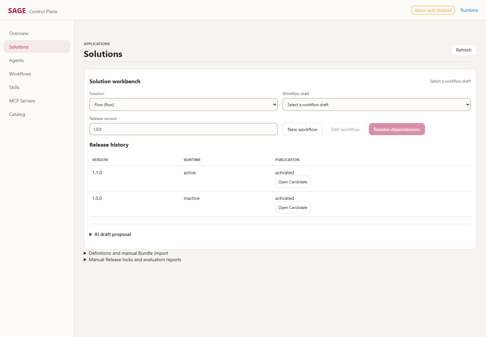

# 创建、发布与运行操作指南

> 2026-09-10 更新：旧 Demo 与业务历史已清空，8012/8015 已停止。
> 当前入口是 <http://127.0.0.1:8014/admin>，请先使用[本地快速测试指南](quick-test.zh-CN.md)。
> 下文保留的是此前的发布机制与演示记录，不代表当前仍有这些已发布资源。

## 1. 先理解“发布”

**保存、校验、构建不是发布。真正生效的边界是 Catalog 激活新的 Generation。**

| 对象 | 用途 | 下一步 | 怎么判断成功 |
| --- | --- | --- | --- |
| MCP Server | 连接外部工具服务器 | Save、Test、Discover | discovered；这不是能力发布 |
| Native Tool | 直接使用 MCP 工具 | Register native tool、Prepare publication | 当前 Generation 中为 active |
| MCP Import as Skill | 把同一 MCP 工具包装成 Skill | Import as Skill、Prepare publication | 包已发布且执行未禁用 |
| 上传 Skill ZIP | 管理 Skill 内容与执行绑定 | Upload、Validate、Prepare publication | 分别检查发布状态和 Execution |
| Agent | 模型指令与允许使用的能力 | Save draft、Validate、Prepare publication | 当前 Generation 中为 active |
| Workflow draft | 可编辑的流程设计 | Review release、Resolve dependencies | 草稿保留是正常现象 |
| Solution | 面向用户的能力组合及授权范围 | 创建或导入 Release，再发布 | Solution 为 active，Release 为当前版本 |
| Release | 不可变的组件版本与摘要锁 | 加入 Candidate | Release history 中 Runtime 为 active |
| Candidate | 一次待发布的变更集合 | 发布或提交审批 | 激活产生 Generation |
| Generation | 平台运行时快照 | 通常不需要手动创建 | Overview 显示其 ID 为当前活动版本 |

开发路径：`draft/valid → Publish → active`。快捷 Publish 内部仍执行校验、带审计的自动审批和激活。

人工路径：`Validate → valid → Submit → pending-approval → Approve → approved → Activate → active`。
生产不提供快捷 Publish；通过 API 强行请求也会被拒绝。本文在本地开发环境演示人工审批，不代表生产认证验收。

`published (historical)` 表示该资源记录曾发布，但不是当前 Generation 中的相同定义。
Candidate 的 `activated (historical)` 表示它产生过一个旧 Generation；其中部分资源仍可能被后续 Generation 继承。
因此不能只根据 Candidate 的历史状态判断某个资源是否仍可用。

## 2. 本次可以直接试用的环境

- 管理台：<http://127.0.0.1:8015/admin>
- 运行工作台：<http://127.0.0.1:8015>
- Temporal UI：<http://127.0.0.1:8234>
- MCP 计算服务：`http://127.0.0.1:8766/mcp`
- 独立数据目录：`%LOCALAPPDATA%\Sage\publish-demo-ready`
- 演示步骤、完整资源 ID 和结果：`%LOCALAPPDATA%\Sage\publication-evidence\ready-manifest.json`

| Demo | 已发布内容 | 验证结果 |
| --- | --- | --- |
| Calc | Native Tool + MCP Skill，Solution `calc@1.0.0` | 两条调用路径都返回 `total: 32.4` |
| Echo | Agent `echo@1.0.0` + 内置 Echo Skill，Solution `echo@1.0.0` | 离线模型实际调用 Echo Skill |
| Flow | Echo Skill → Native Tool → Calc Skill | `1.0.0` 为 32.4；审批激活 `1.1.0` 后为 28.8 |
| Draft | 惰性的 Python ZIP 示例 | valid，但 executable=false；这是安全限制，不是发布故障 |

当前活动 Flow 是 `1.1.0`。工作流草稿保留用于继续编辑，`1.0.0` Release 和旧运行结果保留用于审计。
初始内置 diagnostic-agent 也会存在，因此管理台 Agent 数量大于一个。



[手机 Release 历史截图](images/publication/release-390.png) · [Catalog 截图](images/publication/catalog-1440.png)

### 停止与重新启动

以下命令在项目根目录的 PowerShell 中执行。已有服务运行时不要重复启动；端口冲突时脚本会拒绝启动，不会替你停止其他服务。

```powershell
.\stop-local.cmd -Port 8015
```

该命令只停止 8015 启动器拥有的 API、Worker、Temporal，不停止独立 MCP 进程，也不删数据。
重新启动时在一个终端运行：

```powershell
.\start-local.cmd -Port 8015 -TemporalPort 7234 -TemporalUiPort 8234 -DataRoot "$env:LOCALAPPDATA\Sage\publish-demo-ready" -NoBrowser
```

如果 MCP 8766 尚未运行，在另一个终端启动：

```powershell
.\.venv\Scripts\python.exe scripts/demo_mcp_server.py --port 8766
```

等启动器显示 `SAGE Worker ready` 后再使用页面。MCP 可在自己的终端按 Ctrl+C 停止。
这套环境只监听本机、关闭管理认证、使用离线模型，不适合生产或开放公网。
原 8012/8014 环境及数据没有被本次 demo 脚本修改。

### 重新生成一套独立 demo

首次生成必须使用**全新数据目录**及独立端口；把上述启动参数和下面命令的 URL、Temporal 地址对应修改。
不要对已有业务实例运行脚本。默认根启动器沿用原预览目录，不适合作为“清空重来”的命令。

```powershell
.\.venv\Scripts\python.exe scripts/demo_publication.py --url http://127.0.0.1:8015 --mcp-url http://127.0.0.1:8766/mcp --temporal-target 127.0.0.1:7234 --manifest "$env:LOCALAPPDATA\Sage\publication-evidence\ready-manifest.json"
```

在本次已经完成的环境中，上述命令会复用 manifest，不再创建相同 Candidate、Release、Generation。
脚本拒绝远程 URL、带凭据 URL、生产环境和没有对应 manifest 的非空环境。
manifest 与数据目录需要配套保留；不要删除 manifest 后向同一环境重新播种。
如果请求提交后断网或 manifest 写入失败，应先核对服务器记录再处理，不保证跨 HTTP 响应丢失的 exactly-once。
外部修改过 demo 的定义、Generation 或版本后，不应用旧 manifest 强行恢复。

## 3. 创建 MCP Server 与两种能力

1. 打开 **MCP Servers**，点击 New server。
2. Alias 填 `calc`，Transport 选 `streamable-http`，URL 填 `http://127.0.0.1:8766/mcp`，保存。
3. 点击 **Test**，再点击 **Discover**。发现列表应出现 `calculate_total` 与 `lookup_runbook`。
4. 选择 `calculate_total`。可先用 **Test tool** 验证参数；未发布工具测试和发布是不同操作。
5. Version 填 `1.0.0`，Description 填 `Calculate an order total`，Risk 选 `Read only`。本地计算不产生外部写入；真实业务工具必须按实际风险评审。

两种方式二选一即可；demo 为比较行为才同时使用：

- **Register native tool**：得到 `tool:mcp:<server_id>:calculate_total`，不生成 Skill 包。创建后自动进入 Catalog 并勾选这条注册记录。
- **Import as Skill**：Skill name 填 `calc`，补充 Skill instructions，点击导入。生成带 MCP 绑定的 Skill 包，并进入 Catalog 勾选该包。能力 ID 为 `skill:calc`。

继续按下一节创建 Candidate 并发布。返回 MCP 页面选择服务器，可以在 **Native tool versions** 找到已注册版本和 **Prepare publication**。
Skill 包可在 **Skills** 页面查找。不要反复点击 Import as Skill 来“尝试发布”，每次导入可能创建一个新包。

凭据放在服务器端 Secret Reference，不要写在 URL、Skill instructions 或工具参数中。
更改 MCP URL、配置、schema 或风险评审后，旧绑定可能失效；重新 Test/Discover，并按新版本发布，不绕过摘要检查。

## 4. 所有资源共用的 Catalog 发布步骤

1. 在资源页面点击 **Prepare publication**，或进入 **Catalog** 手动勾选资源。
2. 填写 Title，例如 `Calc 1.0.0`。Default Agent 默认保持 `Keep current default`，无需为发布普通能力修改平台默认 Agent。
3. 核对 Agent drafts、Skill packages、Native tools、Solution Releases 中的选择。点击 **Create candidate**。
4. 在下方 Candidates 表找到新记录。先点击 **Validate** 查看具体错误，也可在开发环境直接点击 **Publish**。
5. 开发 Publish 成功后，检查 Overview 活动 Generation ID、资源 active 状态，随后实际调用验证。
6. 人工审批路径：valid Candidate 点击 **Submit**，在 Approvals 找到对应候选，填写 Decision reason，点击 **Approve**；再回 Candidates 点击 **Activate**。

候选选择会在控制台刷新数据时保留。创建 Candidate 不会发布，导航到 Catalog 也不会自动创建 Candidate。
审批期间若其他发布改变了基础 Generation，或依赖内容变化，应重新核对并创建候选/构建版本，不能直接复用过期审批。

## 5. 创建 Agent

1. 先发布 Agent 需要的能力。最简单的例子使用已内置的 `skill:echo`。
2. 打开 **Agents**，点击 **New agent**。
3. Agent ID 填 `echo`、Name 填 `Echo`、Version 填 `1.0.0`。如果该版本已存在，改用新 ID 或新版本，不覆盖已发布版本。
4. Instructions 填 `Use the echo Skill to repeat the user's message.`，能力列表选择 Echo；demo 的 Memory policy 使用 none。
5. 点击 **Save draft**、**Validate**。成功后在资源列表点击 **Prepare publication**，完成 Catalog 发布。
6. 把该 Agent 和其 Echo Skill 依赖锁入一个支持 Interactive 的 Solution Release，并发布该 Release，业务用户才可在该 Solution 范围使用它。

测试现成 demo：打开运行工作台，Solution 选 **Echo**，Mode 选 **Deep Agent**，Agent 选 **Echo**，输入 `echo publication demo`，点击 **Send**。
期望运行 completed，返回文本含该输入，tool_calls 大于零。

离线 DemoAgentModel 只支持既定演示路径，不是通用推理模型。需要自然语言选择任意 MCP 工具时，另行配置真实模型；发布成功不证明模型认证已成功。
新版本使用 Clone version，不编辑已发布版本。Agent 委派目标也需要按平台规则先发布并可用。

## 6. 创建或上传 Skill

一个有执行绑定的 Skill ZIP 至少包含：

```text
my-skill/
  SKILL.md
  skill.yaml
  main.py        # 仅 python-subprocess 示例需要
```

SKILL.md 提供名称、描述与说明；skill.yaml 定义版本、执行绑定、输入输出 schema、风险和限制。
参考现有 [Echo 目录](../skills/echo) 的包约定，但不要假设把内置包上传就获得相同执行权限。

操作：**Skills → 选择 ZIP → Upload → Validate → Prepare publication → Catalog 发布**。

**当前限制：上传的 Python、builtin、prompt 代码不会因为校验或发布而开放执行。**
Python 包会提示 `uploaded_code_execution_disabled`，需要隔离 Runner 支持；本文没有新增 Runner 或关闭安全检查。
本次 `draft` 示例特意保持 valid、Execution disabled，不加入可执行 demo。
要立即体验可发布可调用的自定义能力，使用前述 **MCP Import as Skill** 路径。
仓库里由受信部署加载的内置 Skill 与控制台上传 Skill 属于不同信任边界。

## 7. 创建 Solution、Workflow 和 Release

### 带 Workflow 的推荐路径

1. **Solutions → Definitions and manual Bundle import** 展开定义表单。
2. Solution ID、Title、Owner 填写自己的值，例如 `flow`、`Flow`、`team`；保留适用的 Allowed roles，并勾选 **Durable** profile。点击 **Create Solution**。
3. 回上方 Solution workbench 选择该 Solution，点击 **New workflow**。
4. 在设计器创建步骤。demo 为 Echo Skill、Native Tool、Calc Skill，依次设置依赖；Native Tool 必须选择已发布的服务器限定目标。
5. Echo 输入 `{"text":"Published Flow"}`；两条计算步骤输入下方 JSON，并关闭不需要的输入继承：

```json
{"unit_price":12,"quantity":3,"discount_percent":10}
```

6. 保存并点击 **Review release**。在工作台选择 Workflow draft，Release version 填 `1.0.0`，点击 **Resolve dependencies**。
7. 检查依赖版本、摘要、风险与警告，勾选 **Dependency locks and risks reviewed**。
8. 点击 **Create Release and Candidate**。此时生成不可变 Release 和 valid Candidate，尚未生效。
9. 开发环境点击 **Publish (development)**；或 **Submit for approval**，到 Catalog 完成审批和 Activate。
10. **Release history** 显示版本、当前 Runtime 状态和 **Open Candidate**。刷新页面后重新选择 Solution，历史仍可查看。

如果组织要求签名，下载 unsigned Bundle，通过组织签名流程处理，然后选择 Signed Bundle、Build signed Bundle。
不要通过切换为开发模式或关闭签名要求绕过生产策略。

### 不带 Workflow 的 Solution

Calc、Echo 使用手工组件锁：**Solutions → Manual Release locks and evaluation reports**。
选择 Solution、版本、Agent/Skill/Native Tool 组件，点击 Create Release；再从 Release history 点击 Prepare publication，完成 Catalog 发布。
组件必须包含实际运行依赖，例如 Echo Agent 及 Echo Skill，不能只选择 Agent 而漏掉其能力。
通常优先使用 Workflow 自动依赖解析，减少手填摘要造成的错误。

### 发布新版本

编辑 Flow 草稿，把折扣从 10 改为 20；Release version 填 `1.1.0`，重新 Resolve、review、Build。
执行 Submit、Approve、Activate 后，新运行返回 `28.8`；旧 `1.0.0` 的运行保持原 Release 绑定。
不要覆盖 `1.0.0` Release。若再次修改本次已经发布的 demo，请使用 `1.2.0`。

## 8. 实际调用与检查结果

### Calc Native Tool

在 PowerShell 中动态获取本机生成的 Tool ID，不手填服务器 UUID：

```powershell
$base = 'http://127.0.0.1:8015'
$tool = (Invoke-RestMethod "$base/v1/admin/tools") | Where-Object { $_.definition.binding.server_alias -eq 'calc' -and $_.definition.binding.tool_name -eq 'calculate_total' }
$request = @{ solution_id='calc'; capability_id=$tool.tool_id; input=@{ unit_price=12; quantity=3; discount_percent=10 }; idempotency_key='guide-native-001' }
Invoke-RestMethod "$base/v1/invocations" -Method Post -ContentType 'application/json' -Body ($request | ConvertTo-Json -Depth 10)
```

检查返回 status=completed，结构化 output 中 total=32.4。MCP 结果可能包装在 structuredContent 中。
相同参数、相同幂等键可回放结果；改变参数或 Release 后必须使用新键。

### Calc Skill

```powershell
$request = @{ solution_id='calc'; capability_id='skill:calc'; input=@{ unit_price=12; quantity=3; discount_percent=10 }; idempotency_key='guide-skill-001' }
Invoke-RestMethod "$base/v1/invocations" -Method Post -ContentType 'application/json' -Body ($request | ConvertTo-Json -Depth 10)
```

也可在运行页面选择 Calc、Direct Skill、calc，填写 Arguments JSON 和一条描述后 Send。
如果环境中已经存在活动 Solution，调用需要正确的 Solution 和 Release 能力锁，不能仅凭全局发布状态调用。

### Flow 的持久化运行

当前运行页面提供 Durable Skill 和 Durable Agent；**Solution Workflow Template 不等同于一个独立 Skill**。
本次 Flow 用已有 Workflow API 启动，不能在 Durable Skill 下找一个不存在的 flow Skill。

```powershell
$request = @{ solution_id='flow'; workflow_type='flow'; payload=@{}; idempotency_key='guide-flow-110-001'; execution_timeout_seconds=120 }
$run = Invoke-RestMethod "$base/v1/durable-runs" -Method Post -ContentType 'application/json' -Body ($request | ConvertTo-Json -Depth 10)
$run
Invoke-RestMethod "$base/v1/durable-runs/$($run.run_id)"
.\tools\temporal\temporal.exe workflow show --address 127.0.0.1:7234 --workflow-id $run.workflow_id --output json
```

启动返回 202，终态应为 completed、solution_release_id 为 flow@1.1.0。Temporal UI 可按 workflow_id 查找执行历史和三个步骤结果。
最终 Native Tool 与 Skill 结果都为 28.8。自动 demo 使用 Temporal SDK 等待并验证最终结果，完整结果保存在 manifest 的 workflow_results。
现有 `/v1/durable-runs/{run_id}/result` 面向 Skill 编排结果，不适用于这个旧式 Workflow Template 路径；此例请用 Temporal 结果。
本地没有 PostgreSQL checkpoint，所以这次不宣称持久化 Agent 的模型中断恢复已通过验证。

## 9. 为什么还停在 draft：排查表

| 现象 | 检查与处理 |
| --- | --- |
| 没有 Prepare publication | Agent/Skill 先 Save、Validate；invalid 查看完整校验报告。Native Tool 在所选服务器的 Native tool versions 找到 |
| Catalog 没有快捷 Publish | 确认是否 production；使用 Validate、Submit、Approve、Activate，不降低环境保护 |
| Candidate 一直 valid | valid 只是校验通过，仍需 Publish 或提交审批 |
| Candidate pending-approval | 到 Approvals 填 reason 并审批，再激活 |
| Approve 后仍未生效 | 检查 Candidate 是否 approved；还需要 Activate |
| Workflow draft 一直存在 | 正常，发布的对象是不可变 Release，不会把编辑草稿删掉 |
| valid Skill 不能运行 | 检查 executable/Execution disabled，上传包的执行限制不是发布按钮问题 |
| 同版本 Agent 被报内容改变 | 本次修复了空 delegations 字段在发布时被删除导致的摘要漂移。旧坏版本仍需 Clone 新版本并重建 Release，不重写历史 |
| Solution Agent/Skill/Tool lock mismatch | 所选版本与摘要不一致，重新解析依赖/创建新版本，不手工改摘要 |
| stale base、review 或 digest changed | 期间发生其他发布或配置变化；重新核对当前 Generation 并构建/审批 |
| API 403、看不到 Solution | 检查身份、角色、Solution allowed_roles、执行 profile 和能力锁；管理权限不等于运行权限 |
| MCP 连接或调用失败 | 服务器进程、URL、允许主机、TLS、凭据引用、发现新鲜度和 schema/config digest 分别检查 |
| 发布成功但 Agent 不会选择工具 | 离线模型只支持固定演示；通用推理需要真实模型配置和认证 |
| durable 返回 503 或一直 running | 检查 Temporal、API/Worker 队列一致、Worker poller 和日志 |
| Windows Access denied | 先检查 Generation 目录占用、权限和端点防护记录；不要关闭防护或删除活动目录来强行发布 |

## 10. 数据整理与安全边界

本次没有清空原来大量 Solution/Release/Generation：这些对象构成依赖锁和运行审计历史，当前没有安全的通用选择性删除 API。
仅 Workflow draft 有删除接口，删除草稿也不代表清理其发布历史。
如果确认整个旧环境都只是测试数据，应安排停止其 API、Worker、Temporal，完整备份 DataRoot、相关运行数据库和 artifact 配置，验证恢复后再决定迁移到新目录。
不要在服务运行中手改 control-plane.json、删除 artifacts/generations 或移动 temporal.db。
本次失败复现目录 publish-demo 与成功目录 publish-demo-ready 分开保留；前者未继续运行，不需拿它作为日常演示环境。

更新代码不会让已运行的旧 API 自动加载修复。需要在合适时间按原有启动方式重启对应服务；本文没有重启原 8012/8014 环境。

## 11. 验证脚本

```powershell
.\.venv\Scripts\python.exe -m pytest tests/test_demo_publication.py tests/test_admin_api.py tests/test_catalog.py tests/test_agent_drafts.py tests/test_skill_packages.py tests/test_tool_registration.py tests/test_solution_build_api.py -q
.\.venv\Scripts\python.exe scripts/smoke_publication.py --url http://127.0.0.1:8015 --output docs/images/publication --live-demo
```

浏览器验收使用本机 Edge 和 Playwright，检查桌面/手机布局、资源选中、历史刷新与生产按钮限制。
发布入口部分使用合成页面状态且不写服务器；`--live-demo` 另行读取真实 Calc/Echo/Flow 数据并验证状态。
真实 MCP、Agent、Temporal 执行由 demo_publication.py 验证，两者不能互相替代。

更多背景：[本地启动与认证](local-durable.zh-CN.md)、[流程设计器](workflow-designer.zh-CN.md)、[原生工具](native-tools.md)。