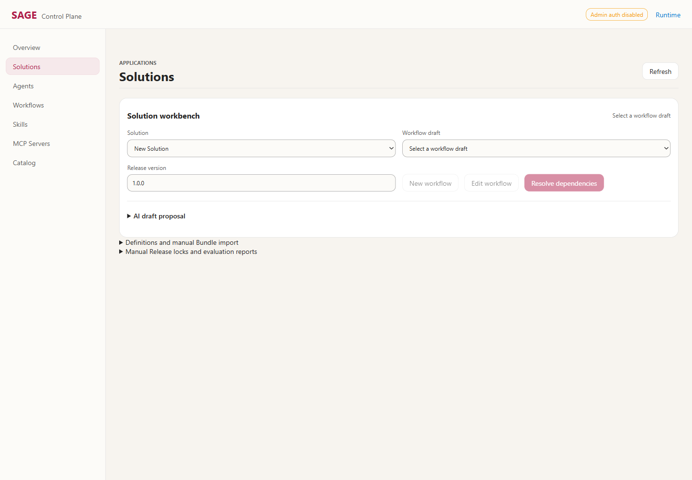

# Solution 创建与发布：Playwright 实际演示

2026-09-10，在 <http://127.0.0.1:8015/admin> 使用可见 Edge 窗口操作。
所有创建、保存、构建和发布均通过页面按钮完成，没有通过 API 预先创建资源，也没有模拟服务器响应。

## 已复现的入口问题

1. Solution 下拉框显示 **New Solution**，但选择它不会打开创建表单。此时 New workflow、Edit workflow、Resolve dependencies 都不可用。
2. 真正的创建表单位于折叠区域 **Definitions and manual Bundle import**，初次进入不可见。
3. 点击 Create Solution 返回 HTTP 201 后，上方下拉框仍为空选项，没有自动选中新建记录。必须自己重新选择，才能创建 Workflow。

此前 smoke_solution_workbench.py 使用 API 创建 Solution，漏测了上述真实创建入口。本次仅新增浏览器演示与证据，未修改这些界面行为。



## 完整操作顺序

| 步骤 | 实际操作 | 截图 |
| --- | --- | --- |
| 1 | Solutions，选择 New Solution，确认不能直接创建 | [初始状态](images/solution-walkthrough/01-new-solution-entry.png) |
| 2 | 展开 Definitions and manual Bundle import；填写 ID、Title、Owner，勾选 Durable | [创建表单](images/solution-walkthrough/02-create-form.png) |
| 3 | 点击 Create Solution；返回上方下拉框，手动选择刚创建的 s89fd | [创建后未自动选择](images/solution-walkthrough/03-created-selection.png) |
| 4 | New workflow；填写标题和 Workflow ID，添加 Skill 节点，Target 选择 echo，Input JSON 填下面的示例 | [Workflow](images/solution-walkthrough/04-workflow.png) |
| 5 | Review release；Resolve dependencies；勾选 Dependency locks and risks reviewed | [依赖审阅](images/solution-walkthrough/05-review-dependencies.png) |
| 6 | Create Release and Candidate，此时仍只是 valid | [尚未发布](images/solution-walkthrough/06-built-not-published.png) |
| 7 | Publish (development)，接受确认对话框，显示 Published | [发布成功](images/solution-walkthrough/07-published.png) |
| 8 | 刷新页面，重新选择 s89fd，Release history 显示 1.0.0 active | [刷新后仍生效](images/solution-walkthrough/08-active-after-reload.png) |

```json
{"text":"UI publication works"}
```

## 演示结果

- Solution：`s89fd`，Release：`s89fd@1.0.0`。
- Candidate：`cand_1cfc4df1d3224b49b1c487d35ae1e5d2`。
- Generation：`gen_20260910081447_02514048`。
- 创建返回 201，发布成功，刷新后仍为 active，浏览器 JavaScript 错误为零。
- 本次验证范围为创建与发布，不包含新 Workflow 的执行。
- 只操作 8015 开发实例，未操作 8012/8014；不能由此断言其他实例没有独立问题。

[完整录屏](images/solution-walkthrough/video/page@71dc719e66ed82ef32c6332d126cf167.webm) · [结构化记录](images/solution-walkthrough/report.json) · [Playwright Trace](images/solution-walkthrough/trace.zip)

## 再次演示

```powershell
.\.venv\Scripts\python.exe scripts/demo_solution_browser.py --url http://127.0.0.1:8015 --output "$env:LOCALAPPDATA\Sage\solution-browser-replay"
```

此命令默认打开可见 Edge，**每次都会创建并发布一个新的演示 Solution**，改变活动 Generation；请只用于允许新增测试数据的开发环境。
本次新增 s89fd 后，旧 demo_publication.py 的 ready-manifest 已不是当前活动 Generation 的完整记录，其拒绝继续写入属于预期防误写行为；不要删除 manifest 或修改历史绕过检查。

结论：在本次实例中，底层发布路径可用，但创建入口和创建后的导航确实会阻断正常使用，需要改善，不能仅靠说明用户“去 Catalog 发布”。